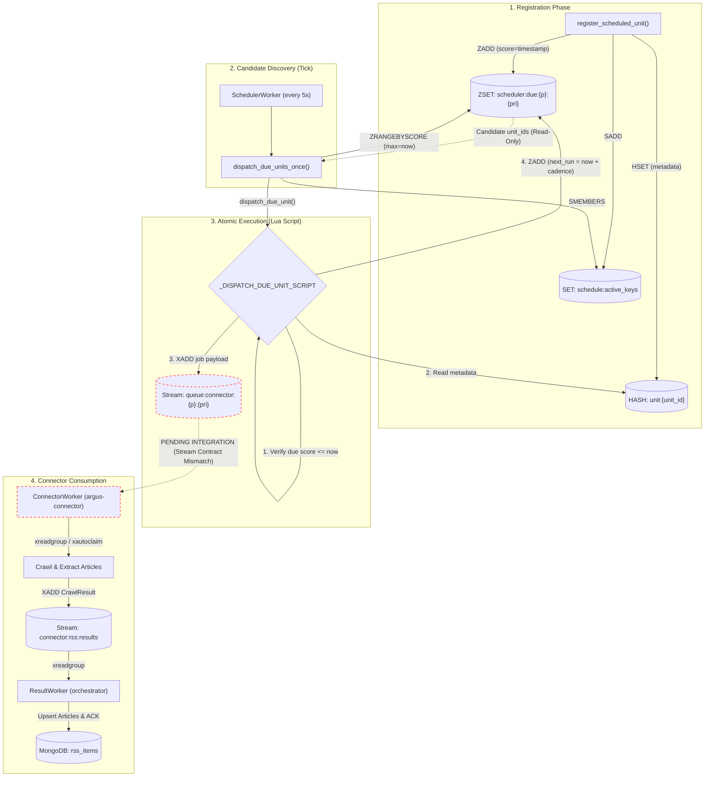

# Argus 2.0: Master Project Guide & Code Walkthrough

This document is the **definitive, step-by-step master guide** for the entire Argus 2.0 system. It covers both microservices — `argus-orchestrator` and `argus-connector` — documenting every architectural decision, every directory, every file, every bug encountered, and every fix applied.

---

## Table of Contents
1. [System Architecture: What Are We Building?](#1-system-architecture-what-are-we-building)
2. [The Request State Lifecycle](#2-the-request-state-lifecycle)
3. [Repository Directory Structures](#3-repository-directory-structures)
4. [argus-orchestrator: File-by-File Walkthrough](#4-argus-orchestrator-file-by-file-walkthrough)
   - [Config: `app/core/config.py`](#file-1-appcoreconfigpy)
   - [Logging: `app/core/logging.py`](#file-2-appcoreloggingpy)
   - [MongoDB Client: `app/platform/mongodb.py`](#file-3-appplatformmongodbpy)
   - [Redis Client: `app/platform/redis.py`](#file-4-appplatformredispy)
   - [FastAPI & Lifespan: `app/main.py`](#file-5-appmainpy)
   - [Health API: `app/api/health.py`](#file-6-appapihealthpy)
   - [Seed Script: `scripts/add_rss_request.py`](#file-7-scriptsadd_rss_requestpy)
   - [Outbound Schema: `app/schemas/request.py`](#file-8-appschemasrequestpy)
   - [Outbound Service: `app/services/request_service.py`](#file-9-appservicesrequest_servicepy)
   - [Outbound Worker: `app/workers/request_worker.py`](#file-10-appworkersrequest_workerpy)
   - [Inbound Schema: `app/schemas/result.py`](#file-11-appschemasresultpy)
   - [Inbound Service: `app/services/result_service.py`](#file-12-appservicesresult_servicepy)
   - [Inbound Worker: `app/workers/result_worker.py`](#file-13-appworkersresult_workerpy)
   - [News Query Schema: `app/schemas/query.py`](#file-14-appschemasquerypy)
   - [Bing URL Builder: `app/services/bing_service.py`](#file-15-appservicesbing_servicepy)
   - [Seed News Queries: `scripts/seed_news_query.py`](#file-16-scriptsseed_news_querypy)
   - [Bing Test Script: `app/test/test_bing.py`](#file-17-apptesttest_bingpy)
   - [Query Dispatch Service: `app/services/query_dispatch_service.py`](#file-18-appservicesquery_dispatch_servicepy)
   - [Request Idempotency Test: `app/test/test_request_idempotency.py`](#file-19-apptesttest_request_idempotencypy)
   - [Scheduler Service: `app/services/scheduler_service.py`](#file-20-appservicesscheduler_servicepy)
   - [Scheduler Worker: `app/workers/scheduler_worker.py`](#file-21-appworkersscheduler_workerpy)
   - [Scheduler Service Test: `app/test/test_scheduler_service.py`](#file-22-apptesttest_scheduler_servicepy)
   - [Scheduler Dispatch Test: `app/test/test_scheduler_dispatch.py`](#file-23-apptesttest_scheduler_dispatchpy)
   - [Scheduler Tick Test: `app/test/test_scheduler_tick.py`](#file-24-apptesttest_scheduler_tickpy)
   - [Scheduler Worker Test: `app/test/test_scheduler_worker.py`](#file-25-apptesttest_scheduler_workerpy)
5. [argus-connector: File-by-File Walkthrough](#5-argus-connector-file-by-file-walkthrough)
   - [Config: `app/core/config.py`](#connector-file-1-appcoreconfigpy)
   - [Logging: `app/core/logging.py`](#connector-file-2-appcoreloggingpy)
   - [Redis Client: `app/platform/redis.py`](#connector-file-3-appplatformredispy)
   - [Connector Schema: `app/schemas/connector.py`](#connector-file-4-appschemasconnectorpy)
   - [Base Connector Abstraction: `app/connectors/base.py`](#connector-file-5-appconnectorsbasepy)
   - [Connector Registry: `app/connectors/registry.py`](#connector-file-6-appconnectorsregistrypy)
   - [RSS Connector: `app/connectors/rss/connector.py`](#connector-file-7-appconnectorsrssconnectorpy)
   - [RSS Data Model: `app/connectors/rss/model.py`](#connector-file-8-appconnectorsrssmodelpy)
   - [RSS Parser: `app/connectors/rss/parser.py`](#connector-file-9-appconnectorsrssparserpy)
   - [Generic Connector Worker & XAUTOCLAIM Recovery: `app/workers/connector_worker.py`](#connector-file-10-appworkersconnector_workerpy)
   - [FastAPI Entrypoint: `app/main.py`](#connector-file-11-appmainpy)
   - [Connector Test Suite: `app/test/`](#connector-file-12-apptest)
   - [NSE Announcements Models: `app/connectors/nse/models.py`](#connector-file-13-appconnectorsnsemodelspy)
   - [NSE XML Parser: `app/connectors/nse/parser.py`](#connector-file-14-appconnectorsnseparserpy)
   - [NSE HTTP Client: `app/connectors/nse/rss.py`](#connector-file-15-appconnectorsnsersspy)
   - [NSE Connector: `app/connectors/nse/connector.py`](#connector-file-16-appconnectorsnseconnectorpy)
   - [NSE Circulars API Client: `app/connectors/nse/circulars.py`](#connector-file-17-appconnectorsnsecircularspy)
6. [End-to-End Pipeline: How to Run the Full System](#6-end-to-end-pipeline-how-to-run-the-full-system)
7. [Bugs Encountered & Fixes Applied](#7-bugs-encountered--fixes-applied)
8. [Current Roadmap & Project Progress](#8-current-roadmap--project-progress)
9. [Implementation Progress: Redis Scheduler and Dispatcher](#9-implementation-progress-redis-scheduler-and-dispatcher)
   - [9.1 System Architecture & Boundary Definitions](#91-system-architecture--boundary-definitions)
   - [9.2 Scheduler Design & Redis Hot-Path Data Structures](#92-scheduler-design--redis-hot-path-data-structures)
   - [9.3 Atomic Dispatch Implementation via Lua](#93-atomic-dispatch-implementation-via-lua)
   - [9.4 Dispatcher Tick & Idempotent Sweeps](#94-dispatcher-tick--idempotent-sweeps)
   - [9.5 Background Scheduler Worker & Lifespan Integration](#95-background-scheduler-worker--lifespan-integration)
   - [9.6 MongoDB Scheduled Units: Durable Configuration vs Hot Path](#96-mongodb-scheduled-units-durable-configuration-vs-hot-path)
   - [9.7 Test Suite & Verification Matrix](#97-test-suite--verification-matrix)
   - [9.8 Critical Architectural Limitations & Hardening Topics](#98-critical-architectural-limitations--hardening-topics)
   - [9.9 Beginner-Friendly Component Breakdown, Flow Diagram & Status Matrix](#99-beginner-friendly-component-breakdown-flow-diagram--status-matrix)

---

## 1. System Architecture: What Are We Building?

Argus 2.0 is an **event-driven, decoupled web intelligence and content ingestion system**.

Instead of building a monolithic script that downloads feeds, parses articles, and saves them in one place, the system is split into two independent microservices communicating exclusively through **Redis Streams**:

```text
┌────────────────────────────────────────────────────────────────────────┐
│                    ARGUS ORCHESTRATOR  (Port 8000)                     │
│                                                                        │
│  scripts/add_rss_request.py                                            │
│         │ (1. Insert 'pending' task into MongoDB)                      │
│         ▼                                                              │
│  [MongoDB: rss_requests]                                               │
│         │ (2. Atomic Claim: status -> 'processing')                    │
│         ▼                                                              │
│  [request_worker.py] --> [request_service.py: dispatch_request]        │
│                                  │                                     │
│                                  │ (3. xadd: Generic ConnectorRequest) │
│                                  │     {request_id, source,            │
│                                  │      source_type, source_url,       │
│                                  │      metadata: "{...}"}             │
└──────────────────────────────────┼─────────────────────────────────────┘
                                   │
                                   ▼
          ┌──────────────────────────────────────────────────┐
          │  Redis Stream: 'queue:connector:rss'             │
          └──────────────────────────────────────────────────┘
                                   │
                                   ▼ (4. Pull via xreadgroup)
┌────────────────────────────────────────────────────────────────────────┐
│                    ARGUS CONNECTOR  (Port 8001)                        │
│                                                                        │
│  [connector_worker.py]                                                 │
│         │                                                              │
│         │ (5. get_connector(request.source_type))                      │
│         ▼                                                              │
│  [registry.py] ──> [rss/connector.py: RSSConnector]                   │
│                           │                                            │
│                           │ (6. httpx fetches feed XML asynchronously) │
│                           │ (7. feedparser extracts articles)          │
│                           ▼                                            │
│                    [CrawlResult payload]                               │
│                           │                                            │
│                           │ (8. xadd: Publish CrawlResult JSON)        │
└───────────────────────────┼────────────────────────────────────────────┘
                            │
                            ▼
          ┌──────────────────────────────────────────────────┐
          │  Redis Stream: 'connector:rss:results'           │
          └──────────────────────────────────────────────────┘
                            │
                            ▼ (9. xreadgroup via consumer group)
┌────────────────────────────────────────────────────────────────────────┐
│                    ARGUS ORCHESTRATOR (continued)                      │
│                                                                        │
│  [result_worker.py] --> [result_service.py]                            │
│                                  │                                     │
│                                  ├──> [MongoDB: rss_items] (Articles)  │
│                                  │    (Bulk upsert, zero duplicates)   │
│                                  │                                     │
│                                  └──> [MongoDB: rss_requests]          │
│                                       (status -> 'completed')          │
└────────────────────────────────────────────────────────────────────────┘
```

### Why This Architecture?
1. **Generic Multi-Connector Extensibility:** The Orchestrator and Connector no longer speak an RSS-only dialect. Tasks are dispatched as generic `ConnectorRequest` objects specifying `source`, `source_type`, `source_url`, and custom `metadata`. Adding a new source (e.g. NSE, BSE, SEBI) simply requires adding an implementation of `BaseConnector` to the connector registry.
2. **Zero Bottlenecks:** The Orchestrator never slows down waiting for external target websites to respond. High latency external crawls are isolated to the connector tier.
3. **Infinite Horizontal Scaling:** Run 1 or 50 connector worker instances across machines. They automatically share the Redis consumer group with load balanced work delivery.
4. **Fault Tolerance:** If a connector worker crashes mid-fetch, Redis maintains the message in the pending entries list (PEL) to be retried.
5. **Stateless Connector:** The connector never touches MongoDB. It reads from Redis and writes to Redis, keeping database credentials and persistence policies centralized in the Orchestrator.

---

## 2. The Request State Lifecycle

Every crawl task in MongoDB's `rss_requests` collection travels through an auditable, strict state machine:

```text
              ┌──────────────┐
              │   pending    │  <-- Job seeded in MongoDB
              └──────┬───────┘
                     │
                     │ (Atomically claimed by request_service.py)
                     ▼
              ┌──────────────┐
              │  processing  │  <-- Dispatched to Redis Stream with 'dispatched_at'
              └──────┬───────┘
                     │
        ┌────────────┴────────────┐
        │ (Connector succeeds)    │ (Connector errors / invalid feed)
        ▼                         ▼
 ┌──────────────┐          ┌──────────────┐
 │  completed   │          │    failed    │
 └──────────────┘          └──────────────┘
```

1. **`pending`**: Job exists in MongoDB with target metadata and `status: "pending"`, awaiting worker pickup.
2. **`processing`**: Atomically claimed by `request_service.py`, `claimed_at` and `dispatched_at` timestamps recorded, task pushed to Redis Stream with `stream_message_id` stored for traceability.
3. **`completed`**: Connector fetched the feed, parsed articles, and Orchestrator's `result_service.py` bulk-upserted them into `rss_items` while updating request status to `completed`.
4. **`failed`**: URL was unreachable, timed out, or had malformed data. `error_message` is recorded for debugging.

---

## 3. Repository Directory Structures

### `argus-orchestrator/`
```text
argus-orchestrator/
├── .env                      # Local environment overrides (passwords, URLs)
├── .env.example              # Template environment variables
├── requirements.txt          # Python dependencies (fastapi, motor, redis, pydantic-settings, uvicorn)
├── PROJECT_GUIDE.md          # THIS FILE: Full architecture & code walkthrough
├── app/
│   ├── main.py               # FastAPI entrypoint with lifespan managing Request, Result & Scheduler workers
│   ├── api/
│   │   └── health.py         # /health and /ready probe endpoints
│   ├── core/
│   │   ├── config.py         # Pydantic Settings loader (including dispatch_tick_seconds)
│   │   └── logging.py        # Centralized logger setup
│   ├── platform/
│   │   ├── mongodb.py        # Async Motor client, collections: news_queries, rss_requests, rss_items, scheduled_units
│   │   └── redis.py          # Async Redis client with decode_responses=True
│   ├── schemas/
│   │   ├── query.py          # NewsQuery model for news_queries collection
│   │   ├── request.py        # Generic ConnectorRequest outbound schema
│   │   └── result.py         # Inbound schema (RSSItem and CrawlResult)
│   ├── services/
│   │   ├── bing_service.py            # Bing search RSS URL builder
│   │   ├── query_dispatch_service.py  # Reads news_queries; creates pending rss_requests
│   │   ├── request_service.py         # Atomic claim, metadata serialization, Redis dispatch
│   │   ├── result_service.py          # Article dedup bulk upsert & job completion
│   │   └── scheduler_service.py       # Redis-based unit registration, candidate lookup & atomic Lua dispatch
│   ├── test/
│   │   ├── test_bing.py                # Verification test for Bing RSS search
│   │   ├── test_request_idempotency.py # Concurrency race & partial unique index test
│   │   ├── test_scheduler_service.py   # Unit registration, metadata storage & due query test
│   │   ├── test_scheduler_dispatch.py  # Atomic dispatch, payload verification & schedule advance test
│   │   ├── test_scheduler_tick.py      # Dispatcher tick sweep & single-run idempotency test
│   │   └── test_scheduler_worker.py    # Background SchedulerWorker periodic ticks & graceful shutdown test
│   └── workers/
│       ├── request_worker.py   # Continuous MongoDB polling dispatcher daemon
│       ├── result_worker.py    # Continuous Redis results consumer daemon
│       └── scheduler_worker.py # Autonomous periodic scheduler dispatcher worker daemon
└── scripts/
    ├── seed_rss_request.py   # CLI tool to seed pending multi-source requests into MongoDB
    └── seed_news_query.py    # Seed query dictionary for targeted Bing news searches
```

### `argus-connector/`
```text
argus-connector/
├── .env                      # Redis URL, stream names, consumer group configuration
├── .env.example              # Template environment variables
├── requirements.txt          # Python dependencies (redis, httpx, feedparser, pydantic-settings, fastapi, uvicorn)
├── test_xautoclaim.py        # Verification script for Redis XAUTOCLAIM stream recovery
├── app/
│   ├── main.py               # FastAPI entrypoint with lifespan managing ConnectorWorker
│   ├── core/
│   │   ├── config.py         # Pydantic Settings (Redis URLs, stream names)
│   │   └── logging.py        # Centralized logger setup
│   ├── platform/
│   │   ├── mongodb.py        # Empty stub (stateless connector does not use Mongo)
│   │   └── redis.py          # Async Redis client with decode_responses=True
│   ├── schemas/
│   │   └── connector.py      # Generic ConnectorRequest inbound schema
│   ├── connectors/
│   │   ├── base.py           # BaseConnector abstract base class (ABC)
│   │   ├── registry.py       # Central dynamic connector registry & lookup
│   │   ├── rss/
│   │   │   ├── connector.py  # RSSConnector implementing BaseConnector
│   │   │   ├── model.py      # RSSItem & CrawlResult Pydantic models with SHA-256 fingerprinting
│   │   │   └── parser.py     # Async HTTP fetcher + feedparser article extractor
│   │   └── nse/
│   │       ├── __init__.py   # NSE package init
│   │       ├── models.py     # NSEAnnouncement & NSECirculars Pydantic models
│   │       ├── parser.py     # ElementTree XML parser (subject marker & datetime parsing)
│   │       ├── rss.py        # Async HTTP client fetching NSE online announcements feed
│   │       ├── circulars.py  # Async HTTP client fetching NSE circulars JSON API
│   │       └── connector.py  # NSEConnector implementing BaseConnector (announcements & circulars)
│   ├── test/
│   │   ├── test_bing_connector.py # Verification test for RSSConnector with Bing query
│   │   ├── test_bing_parser.py    # Verification test for fetch_and_parse_rss with Bing
│   │   ├── test_nse_circular_api.py # Verification test for live NSE Circulars JSON endpoint
│   │   ├── test_nse_circular_connector.py # Verification test for NSEConnector with source_type="nse_circular"
│   │   ├── test_nse_circular_duplicates.py # Verification test analyzing duplicate circular numbers
│   │   ├── test_nse_circular_worker.py # Verification test for end-to-end NSE circular worker dispatch
│   │   ├── test_nse_connector.py  # Verification test for NSEConnector fetch
│   │   ├── test_nse_parser.py     # Verification test for NSE XML parsing
│   │   ├── test_nse_rss.py        # Verification test for live NSE feed download
│   │   ├── test_nse_worker.py     # Verification test for end-to-end NSE worker flow
│   │   ├── test_redis_group.py    # Redis consumer group creation verification
│   │   ├── test_registry.py       # Connector registry lookup test
│   │   └── test_xpending.py       # Verification test inspecting Redis Stream Pending Entries List (PEL)
│   └── workers/
│       └── connector_worker.py # Continuous consumer loop with XREADGROUP and XAUTOCLAIM stale PEL recovery
```

---

## 4. argus-orchestrator: File-by-File Walkthrough

---

### File 1: `app/core/config.py`
**Purpose:** Single source of truth for all configuration values. Reads from `.env` and provides strongly-typed settings.

```python
from pydantic_settings import BaseSettings, SettingsConfigDict

class Settings(BaseSettings):
    app_name: str = "argus-orchestrator"
    app_env: str = "development"
    mongo_url: str = "mongodb://localhost:27017"
    mongo_database: str = "argus"
    redis_url: str = "redis://localhost:6379/0"
    connector_stream: str = "queue:connector:rss"     # Stream we PUSH jobs to
    result_stream: str = "connector:rss:results"      # Stream we READ results from
    consumer_group: str = "orchestrator-results"       # Consumer group for result reading
    consumer_name: str = "orchestrator-1"              # Unique worker name

    dispatch_tick_seconds: int = 5                     # Default cadence for scheduler worker tick

    model_config = SettingsConfigDict(
        env_file=".env",
        case_sensitive=False,
        extra="ignore"   # Prevents crashes if unknown env vars exist
    )

settings = Settings()
```

---

### File 2: `app/core/logging.py`
**Purpose:** Standardizes log output across all workers with consistent timestamp, level, module name formatting.

```python
import logging

def setup_logging():
    logging.basicConfig(
        level=logging.INFO,
        format="%(asctime)s | %(levelname)s | %(name)s | %(message)s |"
    )
```

---

### File 3: `app/platform/mongodb.py`
**Purpose:** Sets up the async MongoDB client using `motor` and defines collection handles.

**Key Concept:** `motor` is async — database queries do not freeze the Python process; other tasks continue running concurrently via `asyncio`.

```python
from motor.motor_asyncio import AsyncIOMotorClient
from app.core.config import settings

mongo_client = AsyncIOMotorClient(settings.mongo_url)
database = mongo_client[settings.mongo_database]

news_queries = database["news_queries"]       # Target queries dictionary for news search
rss_requests = database["rss_requests"]       # Job queue & status tracking
rss_items = database["rss_items"]             # Parsed and stored articles
scheduled_units = database["scheduled_units"] # Scheduled scraping units (collection handle)

async def check_mongodb():
    """Pings MongoDB admin to verify connection is alive."""
    try:
        await mongo_client.admin.command("ping")
        return True
    except Exception:
        return False
```

> [!NOTE]
> `scheduled_units = database["scheduled_units"]` establishes application access to the MongoDB collection designated for persistent scheduled units. However, as verified in the code, a configuration-sync daemon or automated reconciliation loop between MongoDB and Redis is not yet implemented.

---

### File 4: `app/platform/redis.py`
**Purpose:** Sets up the async Redis connection pool.

**Key Setting:** `decode_responses=True` automatically converts Redis byte strings to UTF-8 Python strings, avoiding `b'...'` prefixes everywhere.

```python
import redis.asyncio as redis
from app.core.config import settings

redis_client = redis.from_url(settings.redis_url, decode_responses=True)

async def check_redis():
    """Pings Redis to confirm broker reachability."""
    try:
        response = await redis_client.ping()
        return response is True
    except Exception:
        return False
```

---

### File 5: `app/main.py`
**Purpose:** FastAPI application entrypoint. Uses `lifespan` context manager to automatically start background workers (`RequestWorker`, `ResultWorker`, and `SchedulerWorker`) when Uvicorn boots, and cleanly stop them on shutdown.

```python
import asyncio
from contextlib import asynccontextmanager
from fastapi import FastAPI
from app.api.health import router as health_router
from app.core.logging import setup_logging
from app.workers.request_worker import RequestWorker
from app.workers.result_worker import ResultWorker
from app.workers.scheduler_worker import SchedulerWorker

setup_logging()

request_worker = RequestWorker(poll_interval=2.0)
result_worker = ResultWorker(block_ms=2000, batch_size=10)
scheduler_worker = SchedulerWorker()

background_tasks = []

@asynccontextmanager
async def lifespan(app: FastAPI):
    """Start and stop the Orchestrator background workers."""
    print("Argus Orchestrator starting up on Port 8000...")
    background_tasks = [
        asyncio.create_task(request_worker.start(), name="request-worker"),
        asyncio.create_task(result_worker.start(), name="result-worker"),
        asyncio.create_task(scheduler_worker.run(), name="scheduler-worker"),
    ]
    try:
        yield
    finally:
        print("Argus Orchestrator shutting down...")
        request_worker.stop()
        result_worker.stop()
        await scheduler_worker.stop()
        await asyncio.gather(*background_tasks, return_exceptions=True)
        print("Argus Orchestrator shutdown complete.")

app = FastAPI(title="Argus Orchestrator", version="2.0", lifespan=lifespan)
app.include_router(health_router)

@app.get("/")
async def root():
    return {"service": "argus-orchestrator", "status": "running"}
```

@app.get("/")
async def root():
    return {"service": "argus-orchestrator", "status": "running"}
```

**Run with:**
```bash
uvicorn app.main:app --port 8000 --reload
```

---

### File 6: `app/api/health.py`
**Purpose:** Liveness and readiness probe endpoints for monitoring/infrastructure.

- `GET /health` — Liveness probe. Returns 200 if the process is running.
- `GET /ready` — Readiness probe. Checks both MongoDB and Redis. Returns 503 if either database is down.

---

### File 7: `scripts/add_rss_request.py`
**Purpose:** Developer CLI tool to seed a `pending` multi-source crawl request into MongoDB.

**Updated Generic Schema:**
```python
import uuid
from datetime import datetime, timezone
from app.platform.mongodb import rss_requests

async def seed_request():
    request_doc = {
        "request_id": f"req_{uuid.uuid4().hex[:12]}",
        "source": "bing",
        "source_type": "rss",
        "url": "https://www.bing.com/search?q=business+news&format=rss",
        "metadata": {
            "query": "business news",
            "topic": "business"
        },
        "status": "pending",
        "priority": "HIGH",
        "created_at": datetime.now(timezone.utc),
        "claimed_at": None,
        "dispatched_at": None,
        "completed_at": None,
        "updated_at": None,
        "stream_message_id": None,
        "items_count": 0,
        "new_items_count": 0,
        "error_message": None
    }
    result = await rss_requests.insert_one(request_doc)
    print(f"Seeded pending request with _id: {result.inserted_id}")
```

```bash
# Run from argus-orchestrator:
python -m scripts.add_rss_request
```

---

### File 8: `app/schemas/request.py`
**Purpose:** Pydantic model enforcing the outbound data contract dispatched to Redis Stream `queue:connector:rss`.

```python
from typing import Any
from pydantic import BaseModel, Field

class ConnectorRequest(BaseModel):
    request_id: str
    source: str
    source_type: str
    source_url: str
    metadata: dict[str, Any] = Field(default_factory=dict)
```

**Why Generic?**
Instead of restricting requests to RSS feeds, `ConnectorRequest` represents any source (e.g. `source="nse"`, `source_type="announcements"`, `source_url="..."`, `metadata={"ticker": "RELIANCE"}`).

---

### File 9: `app/services/request_service.py`
**Purpose:** Core outbound business logic — atomically claiming a pending task from MongoDB, validating the schema, stringifying metadata for Redis, and updating audit trails.

**Key Mechanics:**
1. **Atomic Claiming:**
   ```python
   claimed_doc = await rss_requests.find_one_and_update(
       {"status": "pending"},
       {"$set": {"status": "processing", "claimed_at": datetime.now(timezone.utc)}},
       return_document=ReturnDocument.AFTER
   )
   ```
2. **Schema Construction & Validation:**
   ```python
   request_obj = ConnectorRequest(
       request_id=request_id,
       source=claimed_doc["source"],
       source_type=claimed_doc["source_type"],
       source_url=claimed_doc["url"],
       metadata=claimed_doc.get("metadata", {}),
   )
   ```
3. **Redis Stream Serialization:**
   Redis streams store flat key-value pairs where values must be strings or numbers. Dicts cannot be passed directly. The service JSON-encodes `metadata`:
   ```python
   dispatch_time = datetime.now(timezone.utc)
   redis_payload = request_obj.model_dump()
   redis_payload["metadata"] = json.dumps(redis_payload["metadata"])

   stream_message_id = await redis_client.xadd(
       settings.connector_stream,
       redis_payload
   )
   ```
4. **Audit Back-Link:**
   Updates MongoDB with both `stream_message_id` and `dispatched_at` timestamp.
5. **Two-Tier Error Handling:**
   - `ValidationError`: Marks request as `"failed"`.
   - Network `Exception`: Rolls status back to `"pending"` for automatic retry when Redis recovers.

---

### File 10: `app/workers/request_worker.py`
**Purpose:** Autonomous background dispatcher daemon that calls `dispatch_request()` in a loop.

**Key Mechanics:**
- **Drain Mode:** When a task is dispatched, sleeps only `10ms` and immediately loops to clear the backlog.
- **Idle Mode:** When no tasks are pending, waits `poll_interval` (2 seconds) using `asyncio.wait_for(self._stop_event.wait(), timeout=...)`.
- **Clean Shutdown:** Catches cancellation and stop signals without dropping tasks.

---

### File 11: `app/schemas/result.py`
**Purpose:** Inbound Pydantic data models defining the payload received from the connector via Redis Stream `connector:rss:results`.

- **`RSSItem`**: A single parsed article stored in `rss_items`:
  - `item_hash`: SHA-256 fingerprint of the normalized URL (`link.strip().lower()`).
  - `request_id`: Originating job ID.
  - `source`: Publisher/source identifier (e.g. `"bing"`, `"nse"`, `"indian_express"`).
  - `source_type`: Connector category (e.g. `"rss"`, `"nse_announcements"`).
  - `title`: Article or announcement title.
  - `link`: Canonical URL.
  - `description`: Optional raw description snippet.
  - `summary`: Cleaned summary text.
  - `author`: Article author.
  - `subject`: Corporate announcement subject or category (e.g. `"OUTCOME OF BOARD MEETING"`).
  - `metadata`: Optional dictionary holding connector-specific metadata attributes (e.g. `circular_number`, `display_number`, `circular_display_date`, `category`, `company`, `department`, `file_size`, `filename`, `file_department`, `file_extension` for `nse_circular`).
  - `published_at`: Timezone-aware UTC publication timestamp.
  - `created_at`: Ingestion timestamp.
  - `model_post_init()`: Automatically computes `item_hash` from `link` if not already set.
- **`CrawlResult`**:
  - `request_id`: Correlation ID of the original request.
  - `status`: `"success"` or `"failed"`.
  - `item_count`: Total number of items in the batch (standardized from `items_count`).
  - `items`: List of `RSSItem` objects.
  - `error_message`: Error details if status is `"failed"`.
  - `fetched_at`: UTC timestamp of fetch completion.

---

### File 12: `app/services/result_service.py`
**Purpose:** Inbound business logic — saving articles to MongoDB with zero duplicates, maintaining strict indexing guarantees, and updating request status.

**Key Mechanics:**
1. **Index Assurance (`ensure_indexes`)**:
   - `rss_items.item_hash`: Unique index `[("item_hash", 1)]` preventing duplicate articles across all crawl runs.
   - `rss_items.request_id` & `rss_items.published_at`: Fast lookup and temporal filtering indexes.
   - `rss_requests.request_id`: Unique sparse index for request lookups.
   - `rss_requests.active_query_key`: Compound partial unique index:
     ```python
     await rss_requests.create_index(
         [("active_query_key", 1)],
         unique=True,
         partialFilterExpression={
             "$and": [
                 {"status": {"$in": ["pending", "processing"]}},
                 {"active_query_key": {"$exists": True}}
             ]
         }
     )
     ```
     Guarantees that at most **one** active (`pending` or `processing`) request can exist for a given query key at any point in time, completely eliminating race-condition double dispatches.
2. **Zero-Duplicate Bulk Upsert (`$setOnInsert`)**:
   ```python
   UpdateOne(
       {"item_hash": item.item_hash},
       {"$setOnInsert": item.model_dump()},
       upsert=True
   )
   ```
   If the hash exists, MongoDB skips it without error. If new, it inserts the document. `$setOnInsert` ensures existing articles preserve their original `created_at` timestamp.
3. **Status Transition:**
   - On `"success"`: Updates `rss_requests` to `"completed"` with `items_count`, `new_items_count`, and `completed_at`.
   - On `"failed"`: Updates `rss_requests` to `"failed"` with `error_message`.

---

### File 13: `app/workers/result_worker.py`
**Purpose:** Autonomous background consumer daemon that reads crawl results from Redis Stream `connector:rss:results` and passes them to `process_crawl_result()`.

**Key Mechanics:**
1. Ensures consumer group exists (`xgroup_create` with `mkstream=True`).
2. Reads messages using `xreadgroup` (`">"` for new undelivered messages).
3. Parses JSON payloads (handles both `"payload"` and `"items"` string encodings).
4. Only executes `xack()` **after** database persistence succeeds (guaranteeing at-least-once delivery).

---

### File 14: `app/schemas/query.py`
**Purpose:** Pydantic model for persistent topic and keyword search queries stored in MongoDB's `news_queries` collection.

```python
from datetime import datetime, timezone
from typing import Any
from pydantic import BaseModel, Field

class NewQuery(BaseModel):
    source: str = "bing"
    source_type: str = "rss"
    topic: str
    query: str
    enabled: bool = True
    priority: str = "HIGH"
    metadata: dict[str, Any] = Field(default_factory=dict)
    created_at: datetime = Field(default_factory=lambda: datetime.now(timezone.utc))
    updated_at: datetime = Field(default_factory=lambda: datetime.now(timezone.utc))
```

---

### File 15: `app/services/bing_service.py`
**Purpose:** URL construction utility for Bing News RSS search queries. Encodes search phrases into valid RSS endpoints.

```python
from urllib.parse import quote_plus

def build_bing_rss_url(query: str) -> str:
    encoded_query = quote_plus(query.strip())
    return f"https://www.bing.com/search?q={encoded_query}&format=rss"
```

---

### File 16: `scripts/seed_news_query.py`
**Purpose:** Database initialization script that seeds target news keywords into `news_queries` collection.

**Key Mechanics:**
- Creates a unique compound index on `("source", 1), ("query", 1)` to prevent duplicate search jobs.
- Seeds default topics: `"business news"`, `"corporate news"`, `"company news"`, and `"corporate sector"`.
- Uses `$setOnInsert` via `upsert=True` to maintain idempotency without overwriting existing query statuses.

```bash
# Run from argus-orchestrator:
python scripts/seed_news_query.py
```

---

### File 17: `app/test/test_bing.py`
**Purpose:** Standalone verification script for Bing Search RSS feeds using `requests` and `feedparser`.

- Generates query URL using `build_bing_rss_url("business news")`.
- Fetches feed using realistic browser `User-Agent`.
- Parses returned XML and prints article titles, links, and publication timestamps to verify feed availability.

---

### File 18: `app/services/query_dispatch_service.py`
**Purpose:** Closes the query-to-request automation loop. Reads all enabled search queries from the `news_queries` collection, converts each query into a Bing RSS URL via `build_bing_rss_url()`, and inserts a ready-to-crawl `pending` document into `rss_requests` — without creating duplicates.

#### Why It Exists
Before this service, pending crawl tasks were created exclusively by manually running `scripts/add_rss_request.py` with a hardcoded URL. That meant a human had to be involved every time a new article batch was needed. `query_dispatch_service.py` automates this: it bridges the static query dictionary (seeded by `seed_news_query.py`) to the live crawl queue (`rss_requests`), enabling fully autonomous periodic re-crawling.

#### What It Reads
Queries the `news_queries` MongoDB collection for documents where `enabled: True`. Each document provides:
- `query` — search phrase (e.g. `"business news"`)
- `source` — platform identifier (e.g. `"bing"`)
- `source_type` — connector type (e.g. `"rss"`)
- `topic` — thematic label carried into request metadata
- `priority` — scheduling priority (`HIGH`, `NORMAL`)

#### How It Creates `rss_requests`
For each enabled query, the service:
1. Checks if an **active request** already exists (`status: pending | processing`) for the same `source` + `metadata.query` pair.
2. If one exists, it **skips** the query (preventing double-dispatch).
3. If none exists, it:
   - Builds the target URL: `build_bing_rss_url(query)` → `https://www.bing.com/search?q=...&format=rss`
   - Inserts a fully-formed request document into `rss_requests` with:
     - `status: "pending"`, `request_id`, `source`, `source_type`, `url`, `metadata`, audit timestamps

#### Duplicate Prevention Strategy
The duplicate check uses normalized keys and dual-layer protection:
1. **Application-Level Check:** Computes `active_query_key = f"{source}:{source_type}:{normalized_query}"` and queries `find_one({"active_query_key": active_query_key, "status": {"$in": ["pending", "processing"]}})`. If found, skips creation.
2. **Database-Level Constraint:** If two concurrent dispatchers execute simultaneously, MongoDB's partial unique index on `active_query_key` raises a `DuplicateKeyError`. `query_dispatch_service.py` catches this exception and gracefully logs it as a skipped duplicate:
```python
try:
    await rss_requests.insert_one(request_doc)
    created_count += 1
except DuplicateKeyError:
    skipped_count += 1
    logger.info("Skipping query '%s'. An active request already exists", query)
```
This guarantees that no duplicate crawl jobs are queued regardless of worker concurrency or execution overlap.

#### Architecture Position
```text
[MongoDB: news_queries]                   (seeded by seed_news_query.py)
       │
       │  (1. Find all enabled=True queries)
       ▼
[query_dispatch_service.py]
       │  (2. Duplicate check: any pending|processing for this query?)
       │  (3. build_bing_rss_url(query) → RSS endpoint)
       │  (4. insert_one → rss_requests, status: "pending")
       ▼
[MongoDB: rss_requests]                   (picked up by request_worker.py)
       │
       │  (5. Atomic claim: status → "processing")
       ▼
[request_service.py] → Redis Stream: 'queue:connector:rss'
```

#### How It Connects to `request_worker.py`
`query_dispatch_service.py` and `request_worker.py` are intentionally **decoupled**. The dispatch service only writes to `rss_requests`. The `RequestWorker` daemon independently polls `rss_requests` for `pending` documents every `poll_interval` seconds. This separation means:
- The dispatch service can run on demand, on a schedule, or from an API endpoint.
- The worker never needs to know *where* the pending task came from — it just claims and dispatches whatever is `pending`.

#### How to Run
```bash
# Standalone — from argus-orchestrator directory:
python -m app.services.query_dispatch_service

# Or call programmatically from any async context:
from app.services.query_dispatch_service import dispatch_news_queries
result = await dispatch_news_queries()
# returns: {"created": N, "skipped": M}
```

---

### File 19: `app/test/test_request_idempotency.py`
**Purpose:** Concurrency verification test demonstrating that duplicate active requests with identical `active_query_key` cannot be created concurrently.

**Key Mechanics:**
- Simulates two workers (`worker-A` and `worker-B`) racing via `asyncio.gather()` to insert a request for the exact same `active_query_key`.
- Proves that exactly one worker succeeds (`CREATED`) and the other catches `DuplicateKeyError` (`SKIPPED`).
- Validates that MongoDB's partial unique index strictly caps active requests for the key at `1`.

---

### File 20: `app/services/scheduler_service.py`
**Purpose:** Core scheduling service providing Redis-based scheduled unit registration, due candidate discovery, and atomic dispatch using a custom Lua script.

**Key Functions & Redis Structures:**
1. **Key Helpers:**
   - `_due_key(platform, priority)`: Returns `scheduler:due:{platform}:{priority}` (Redis Sorted Set, where score = Unix timestamp).
   - `_unit_key(unit_id)`: Returns `unit:{unit_id}` (Redis Hash holding metadata).
   - `ACTIVE_KEYS_SET = "schedule:active_keys"`: Redis Set tracking active platform/priority combinations.
2. **`register_scheduled_unit()`**:
   - Validates inputs (`cadence_seconds > 0`, non-empty strings).
   - Serializes `search_options` to JSON and normalizes metadata strings.
   - Executes atomic pipeline:
     - `pipe.zadd(due_key, {unit_id: next_run_at})`
     - `pipe.hset(unit_key, mapping=metadata)`
     - `pipe.sadd(ACTIVE_KEYS_SET, unit_key)`
3. **`get_due_unit_id()`**:
   - Read-only candidate query: queries Redis Sorted Set with `zrangebyscore(due_key, min="-inf", max=current_time, num=limit)`.
   - Explicitly does **not** claim, lock, or pop units.
4. **`dispatch_due_unit()`**:
   - Invokes Redis Lua script `_DISPATCH_DUE_UNIT_SCRIPT` with keys `[due_key, unit_key, stream_name]`.
   - Lua script checks due timestamp, verifies metadata, drops disabled units, publishes job to `queue:connector:{platform}:{priority}` via `XADD`, advances schedule to `now + cadence` via `ZADD`, and returns `{1, stream_id, next_run_at, request_id}`.
5. **`dispatch_due_units_once()`**:
   - Sweeps active registry keys (or optional `platform_priority_keys` filter for isolated tests).
   - Fetches due candidate unit IDs and executes `dispatch_due_unit()` for each.
   - Returns count of successfully dispatched units.

---

### File 21: `app/workers/scheduler_worker.py`
**Purpose:** Autonomous background daemon that runs dispatcher ticks on a recurring timer (`dispatch_tick_seconds`, default 5s).

**Key Mechanics:**
- **Initialization:** Reads `dispatch_tick_seconds` from `app.core.config.settings`.
- **`run_once()`:** Invokes `dispatch_due_units_once()` and logs the number of dispatched units.
- **`run()`:** Continuous async loop:
  - Executes `run_once()`.
  - Catches ordinary exceptions, logs `"Scheduler tick failed."`, and continues running without terminating the worker.
  - Waits `tick_seconds` using `asyncio.wait_for(self._stop_event.wait(), timeout=self.tick_seconds)`.
- **`stop()`:** Sets `_stop_event` to break the loop and ensure graceful application shutdown.
- **FastAPI Integration:** Instantiated and supervised within `app/main.py` lifespan alongside `RequestWorker` and `ResultWorker`.

---

### File 22: `app/test/test_scheduler_service.py`
**Purpose:** Unit test verifying scheduled unit registration, Redis Hash metadata storage, and time-based due lookups.

**Verifications:**
- Registers a unit scheduled 60 seconds into the future.
- Confirms hash fields `term` and `cadence_seconds` match in Redis `unit:{unit_id}`.
- Confirms unit is **not** returned when `now = future_time - 1`.
- Confirms unit **is** returned when `now = future_time`.
- Cleans up created test keys upon completion.

---

### File 23: `app/test/test_scheduler_dispatch.py`
**Purpose:** Verification test confirming atomic dispatch via Lua script, stream publication, schedule advancement, and repeat dispatch prevention.

**Verifications:**
- Registers a due unit with `next_run_at = now - 1`.
- Dispatches via `dispatch_due_unit()`, asserting success.
- Verifies published message exists in `queue:connector:{platform}:{priority}` with accurate `term` and `unit_id`.
- Verifies unit's score in sorted set advanced into the future (`next_run > now`).
- Calls `dispatch_due_unit()` a second time at the exact same timestamp; confirms return is `None` and stream message count remains 1.

---

### File 24: `app/test/test_scheduler_tick.py`
**Purpose:** Verification test confirming `dispatch_due_units_once()` executes full candidate sweep and preserves idempotency on repeated ticks.

**Verifications:**
- Registers a due unit and runs one dispatcher tick with `platform_priority_keys={active_key}`.
- Confirms returned dispatch count is `1`.
- Confirms job is placed in target connector stream.
- Executes second tick immediately at identical `now` timestamp; asserts count is `0`.

---

### File 25: `app/test/test_scheduler_worker.py`
**Purpose:** Verification test confirming `SchedulerWorker` loop lifecycle, periodic ticks, and clean graceful shutdown.

**Verifications:**
- Configures `SchedulerWorker(tick_seconds=0.05)`.
- Temporarily patches `dispatch_due_units_once` with a test counter.
- Test counter requests `await worker.stop()` upon reaching 3 ticks.
- Runs `worker.run()` with `asyncio.wait_for(timeout=2)`.
- Asserts exactly 3 ticks executed and worker exited cleanly.

---

## 5. argus-connector: File-by-File Walkthrough

The connector is a **stateless, database-agnostic scraping service**. It communicates solely through Redis Streams — it never connects to MongoDB.

---

### Connector File 1: `app/core/config.py`
**Purpose:** Reads connector-specific settings from `.env`.

```python
from pydantic_settings import BaseSettings, SettingsConfigDict

class Settings(BaseSettings):
    app_name: str = "argus-connector"
    redis_url: str = "redis://localhost:6379/0"
    connector_stream: str = "queue:connector:rss"   # Stream we READ jobs from
    result_stream: str = "connector:rss:results"    # Stream we WRITE results to
    consumer_group: str = "rss_connectors"           # Consumer group (shared by workers)
    consumer_name: str = "connector_worker-1"        # Unique ID for THIS worker instance

    model_config = SettingsConfigDict(
        env_file=".env",
        case_sensitive=False,
        extra="ignore"
    )

settings = Settings()
```

---

### Connector File 2: `app/core/logging.py`
**Purpose:** Identical logging setup to Orchestrator for consistent log output across both microservices.

---

### Connector File 3: `app/platform/redis.py`
**Purpose:** Async Redis client initialized with `decode_responses=True`.

---

### Connector File 4: `app/schemas/connector.py`
**Purpose:** Inbound request contract representing tasks pulled from the Redis stream.

```python
from typing import Any, Optional
from pydantic import BaseModel, Field

class ConnectorRequest(BaseModel):
    request_id: str
    source: str
    source_type: Optional[str] = None
    source_url: Optional[str] = None    
    metadata: dict[str, Any] = Field(default_factory=dict)
```

---

### Connector File 5: `app/connectors/base.py`
**Purpose:** Abstract Base Class (ABC) defining the standard interface that every data connector must implement.

```python
from abc import ABC, abstractmethod

class BaseConnector(ABC):

    @abstractmethod
    async def fetch(self, request):
        """Fetch and return structured crawl results for the given ConnectorRequest."""
        pass
```

**Why This Abstraction?**
Every future connector (NSE, BSE, SEBI, Bing, Twitter/X) implements this exact `fetch()` method. The worker daemon interacts only with `BaseConnector`, making the worker 100% connector-agnostic.

---

### Connector File 6: `app/connectors/registry.py`
**Purpose:** Central connector factory and registry mapping source types to connector instances.

```python
from app.connectors.rss.connector import RSSConnector
from app.connectors.nse.connector import NSEConnector

CONNECTORS = {
    "rss": RSSConnector(),
    "nse_announcements": NSEConnector(),
}

def get_connector(source_type: str):
    connector = CONNECTORS.get(source_type)
    if not connector:
        raise ValueError(f"Unsupported connector: {source_type}")
    return connector
```

---

### Connector File 7: `app/connectors/rss/connector.py`
**Purpose:** Concrete implementation of `BaseConnector` for RSS feeds.

```python
from app.connectors.base import BaseConnector
from app.connectors.rss.parser import fetch_and_parse_rss

class RSSConnector(BaseConnector):
    
    async def fetch(self, request):
        return await fetch_and_parse_rss(
            request_id=request.request_id,
            source=request.source,
            source_type=request.source_type,
            url=request.source_url,
        )
```

---

### Connector File 8: `app/connectors/rss/model.py`
**Purpose:** Data models for RSS articles and batch results. Standardized to match the Orchestrator's `app/schemas/result.py`.

```python
import hashlib
from datetime import datetime, timezone
from typing import List, Optional
from pydantic import BaseModel, Field

class RSSItem(BaseModel):
    item_hash: Optional[str] = None
    request_id: str
    source: str
    source_type: str
    title: str
    link: str                    # Standardized 'link' matches Orchestrator
    description: Optional[str] = None
    summary: Optional[str] = None
    author: Optional[str] = None
    subject: Optional[str] = None # Corporate announcement subject / category
    published_at: Optional[datetime] = None
    created_at: datetime = Field(default_factory=lambda: datetime.now(timezone.utc))

    def compute_hash(self) -> str:
        """Generates SHA-256 fingerprint from normalized link."""
        raw = self.link.strip().lower()
        return hashlib.sha256(raw.encode("utf-8")).hexdigest()

    def model_post_init(self, __context):
        if not self.item_hash and self.link:
            self.item_hash = self.compute_hash()

class CrawlResult(BaseModel):
    request_id: str
    status: str = "success"
    item_count: int = 0          # Standardized from items_count
    items: List[RSSItem] = Field(default_factory=list)
    error_message: Optional[str] = None
    fetched_at: datetime = Field(default_factory=lambda: datetime.now(timezone.utc))
```

---

### Connector File 9: `app/connectors/rss/parser.py`
**Purpose:** Asynchronous HTTP fetcher and parser using `httpx.AsyncClient` and `feedparser`.

- Signature: `fetch_and_parse_rss(request_id: str, source: str, source_type: str, url: str) -> CrawlResult`.
- Propagates `source` and `source_type` down to each created `RSSItem` for end-to-end data provenance.
- Uses a realistic `User-Agent` header to prevent bot blocking.
- Converts publication timestamps (`published_parsed` / `updated_parsed`) to timezone-aware UTC datetimes.
- Returns `CrawlResult(status="failed", error_message=...)` on network timeouts, HTTP errors, or unparseable feeds.

---

### Connector File 10: `app/workers/connector_worker.py`
**Purpose:** The generic continuous worker daemon that pulls tasks from Redis, safely parses parameters and metadata, resolves the connector via the registry, executes `fetch()`, publishes results, acknowledges with `xack`, and recovers stale unacknowledged messages using `XAUTOCLAIM`.

**Key Mechanics:**
1. **Safe Metadata Deserialization:**
   ```python
   metadata_raw = fields.get("metadata", {})
   try:
       metadata = json.loads(metadata_raw)
   except (TypeError, json.JSONDecodeError):
       logger.warning(f"Invalid metadata for message {message_id}. Using empty metadata.")
       metadata = {}
   ```
2. **Validation Guard:**
   Ensures `request_id`, `source`, `source_type`, and `source_url` exist. If missing, logs error and acknowledges message with `xack` to prevent poisoned message loops.
3. **Dynamic Connector Dispatch:**
   ```python
   request = ConnectorRequest(
       request_id=request_id,
       source=source,
       source_type=source_type,
       source_url=source_url,
       metadata=metadata,
   )
   connector = get_connector(request.source_type)
   crawl_result = await connector.fetch(request)
   ```
4. **Publish & Acknowledge:**
   Publishes `crawl_result.model_dump_json()` to `result_stream` and calls `redis_client.xack()`.
5. **Autonomous Stale Pending Message Recovery (`XAUTOCLAIM`):**
   If a connector worker instance terminates or crashes while executing an external HTTP crawl, the pulled message remains in the Redis consumer group's **Pending Entries List (PEL)**.
   The updated `ConnectorWorker` implements a dedicated background recovery task:
   ```python
   # Runs every recovery_interval (10s)
   next_start_id, messages = await redis_client.xautoclaim(
       name=self.stream_name,
       groupname=self.group_name,
       consumername=self.consumer_name,
       min_idle_time=self.claim_idle_ms,  # 30,000 ms (30s)
       start_id=claim_start_id,
       count=self.batch_size,
   )
   ```
   Any pending message that has been idle for more than `claim_idle_ms` (30 seconds) is transferred to this worker, re-crawled, published to results, and acknowledged via `xack`, preventing orphaned tasks from getting lost forever.

---

### Connector File 11: `app/main.py`
**Purpose:** FastAPI service entrypoint managing `ConnectorWorker` lifecycle via `lifespan`.

```python
import asyncio
from contextlib import asynccontextmanager
from fastapi import FastAPI
from app.core.logging import setup_logging
from app.platform.redis import check_redis
from app.workers.connector_worker import ConnectorWorker

setup_logging()

worker = ConnectorWorker(block_ms=2000, batch_size=5)
worker_task = None

@asynccontextmanager
async def lifespan(app: FastAPI):
    global worker_task
    print("Argus Connector starting up on port 8001...")
    worker_task = asyncio.create_task(worker.start())
    yield
    print("Argus Connector shutting down...")
    worker.stop()
    if worker_task:
        await asyncio.gather(worker_task, return_exceptions=True)
    print("Argus Connector shutdown gracefully!")

app = FastAPI(title="Argus Connector", version="2.0", lifespan=lifespan)

@app.get("/")
async def root():
    return {"service": "argus-connector", "status": "running"}

@app.get("/health")
async def health():
    redis_ok = await check_redis()
    return {"status": "Healthy" if redis_ok else "unhealthy", "redis": "connected" if redis_ok else "disconnected"}
```

**Run with:**
```bash
uvicorn app.main:app --port 8001 --reload
```

---

### Connector File 12: `app/test/` (Verification Test Suite)
**Purpose:** Standalone verification scripts to validate XML parser parsing and dynamic connector registry execution without spinning up full service daemons.

> [!NOTE]
> Verification scripts located inside `app/test/` are temporary developer smoke tests used during active connector creation. They can be run individually or eventually migrated to a standard root `tests/` directory with `pytest` mocks.

- **`test_bing_parser.py`**: Validates `fetch_and_parse_rss()` against live Bing News feeds.
- **`test_bing_connector.py`**: Validates dynamic connector dispatch resolving `RSSConnector`.
- **`test_nse_parser.py`**: Validates XML parsing, subject extraction (`|SUBJECT:`), and datetime parsing.
- **`test_nse_rss.py`**: Validates direct HTTP download from `nsearchives.nseindia.com`.
- **`test_nse_connector.py`**: Validates `NSEConnector.fetch()` mapping into standardized `CrawlResult`.
- **`test_nse_worker.py`**: Validates worker dispatch for `source_type="nse_announcements"`.
- **`test_nse_circular_api.py`**: Validates direct HTTP calls to the NSE Circulars REST endpoint (`https://www.nseindia.com/api/circulars`) with date parameters and extracts parsed circular records.
- **`test_nse_circular_duplicates.py`**: Validates circular date parsing and checks for duplicate circular numbers and display numbers across multiple departments.
- **`test_nse_circular_connector.py`**: Validates `NSEConnector.fetch()` mapping circulars into standardized `CrawlResult` and `RSSItem` with full metadata payload.
- **`test_nse_circular_worker.py`**: Verifies end-to-end Redis Stream dispatch (`connector:requests` -> `connector_worker` -> `connector:rss:results`).
- **`test_redis_group.py`**: Verifies Redis consumer group initialization.
- **`test_registry.py`**: Verifies registry lookup for `"rss"`, `"nse_announcements"`, and `"nse_circular"`.
- **`test_xpending.py`**: Inspects Redis Stream Pending Entries List (`XPENDING`) to observe in-flight message state.
- **`test_xautoclaim.py`**: Verifies `XAUTOCLAIM` recovery by seeding unacknowledged pending tasks and asserting automatic worker reclamation.

---

### Connector File 13: `app/connectors/nse/models.py`
**Purpose:** Dedicated Pydantic models representing corporate announcements and official regulatory circulars from the National Stock Exchange of India (NSE).

```python
from datetime import datetime, timezone
from typing import Optional 
from pydantic import BaseModel, Field

class NSEAnnouncement(BaseModel):
    request_id: str
    source: str
    source_type: str
    title: str
    link: Optional[str] = None
    description: Optional[str] = None
    subject: Optional[str] = None
    published_at: Optional[datetime] = None
    created_at: datetime = Field(
        default_factory=lambda: datetime.now(timezone.utc)
    )


class NSECirculars(BaseModel):
    request_id: str
    source: str
    source_type: str
    circular_date: Optional[datetime] = None
    circular_display_date: Optional[str] = None
    category: Optional[str] = None
    company: Optional[str] = None
    department: Optional[str] = None
    display_number: Optional[str] = None
    circular_number: Optional[str] = None
    subject: Optional[str] = None
    file_link: Optional[str] = None
    file_size: Optional[str] = None
    filename: Optional[str] = None
    file_department: Optional[str] = None
    file_extension: Optional[str] = None
    created_at: datetime = Field(
        default_factory=lambda: datetime.now(timezone.utc)
    )
```

---

### Connector File 14: `app/connectors/nse/parser.py`
**Purpose:** XML parser using standard library `xml.etree.ElementTree` with specialized extraction for NSE description metadata and publication dates.

**Key Mechanics:**
1. **Subject Marker Extraction (`parse_subject`)**:
   NSE online announcements pack corporate subjects into the description string following a `|SUBJECT:` delimiter (e.g. `"... |SUBJECT: Financial Results"`). The parser safely splits and extracts this string:
   ```python
   def parse_subject(description: Optional[str]) -> Optional[str]:
       if not description or "|SUBJECT:" not in description:
           return None
       return description.split("|SUBJECT:", 1)[1].strip() or None
   ```
2. **Custom Date Formatting (`parse_published_at`)**:
   Parses NSE's specific timestamp format (`%d-%b-%Y %H:%M:%S`, e.g., `29-Sep-2026 17:45:00`) and converts it to a timezone-aware UTC datetime.
3. **ElementTree Traversal (`parse_nse_rss`)**:
   Iterates through each `<item>` node in the RSS feed and maps elements into clean `NSEAnnouncement` models.

---

### Connector File 15: `app/connectors/nse/rss.py`
**Purpose:** Asynchronous HTTP client configured specifically to retrieve the official NSE online announcements feed.

**Key Mechanics:**
- **Endpoint:** `https://nsearchives.nseindia.com//content/RSS/Online_announcements.xml`
- **Browser-Identical Headers:** Uses a Chrome Windows user-agent and XML accept headers to prevent HTTP 403 / anti-scraping blocks from NSE's archive servers.
- **Timeout & Redirects:** 30.0s timeout with `follow_redirects=True`.
- Returns parsed list of `NSEAnnouncement` objects via `parse_nse_rss()`.

---

### Connector File 16: `app/connectors/nse/connector.py`
**Purpose:** Concrete implementation of `BaseConnector` for NSE Corporate Announcements and NSE Circulars.

**Key Mechanics:**
- Implements `async def fetch(self, request: ConnectorRequest) -> CrawlResult`.
- Dispatches based on `request.source_type`:
  - `"nse_announcements"`: Calls `_fetch_announcements()` -> `fetch_nse_rss()` -> `_announcement_to_rss_item()`.
  - `"nse_circular"`: Calls `_fetch_circulars()` -> `fetch_nse_circulars()` -> `_circular_to_rss_item()`.
- Standardizes both data streams into `RSSItem` objects:
  - Preserves `subject` across both sources.
  - Attaches rich circular metadata (`circular_number`, `display_number`, `circular_display_date`, `category`, `company`, `department`, `file_size`, `filename`, `file_department`, `file_extension`) in `RSSItem.metadata`.
- Returns a standardized `CrawlResult(status="success", item_count=len(items), items=items)`.

```python
class NSEConnector(BaseConnector):

    async def fetch(self, request: ConnectorRequest) -> CrawlResult:
        if request.source_type == "nse_announcements":
            return await self._fetch_announcements(request)
        if request.source_type == "nse_circular":
            return await self._fetch_circulars(request)
        raise ValueError(f"Unsupported NSE source_type: {request.source_type}")

    async def _fetch_announcements(self, request: ConnectorRequest) -> CrawlResult:
        announcements = await fetch_nse_rss(request_id=request.request_id)
        items = [self._announcement_to_rss_item(a) for a in announcements]
        return CrawlResult(request_id=request.request_id, status="success", item_count=len(items), items=items)

    async def _fetch_circulars(self, request: ConnectorRequest) -> CrawlResult:
        from_date = request.metadata.get("from_date")
        to_date = request.metadata.get("to_date")
        if not from_date or not to_date:
            raise ValueError("from_date and to_date are required for NSE circulars")
        circulars = await fetch_nse_circulars(request_id=request.request_id, from_date=from_date, to_date=to_date)
        items = [self._circular_to_rss_item(c) for c in circulars]
        return CrawlResult(request_id=request.request_id, status="success", item_count=len(items), items=items)

    @staticmethod
    def _announcement_to_rss_item(announcement: NSEAnnouncement) -> RSSItem:
        return RSSItem(
            request_id=announcement.request_id,
            source=announcement.source,
            source_type=announcement.source_type,
            title=announcement.title,
            link=announcement.link or "",
            description=announcement.description,
            subject=announcement.subject,
            published_at=announcement.published_at,
        )

    @staticmethod
    def _circular_to_rss_item(circular: NSECirculars) -> RSSItem:
        return RSSItem(
            request_id=circular.request_id,
            source=circular.source,
            source_type=circular.source_type,
            title=circular.subject or circular.display_number or "NSE Circular",
            link=circular.file_link or "",
            description=circular.subject,
            subject=circular.subject,
            published_at=circular.circular_date,
            metadata={
                "circular_number": circular.circular_number,
                "display_number": circular.display_number,
                "circular_display_date": circular.circular_display_date,
                "category": circular.category,
                "company": circular.company,
                "department": circular.department,
                "file_size": circular.file_size,
                "filename": circular.filename,
                "file_department": circular.file_department,
                "file_extension": circular.file_extension,
            },
        )
```

---

### Connector File 17: `app/connectors/nse/circulars.py`
**Purpose:** Asynchronous HTTP client configured specifically to retrieve official NSE circulars via REST/JSON endpoint.

**Key Mechanics:**
- **Endpoint:** `https://www.nseindia.com/api/circulars` with `fromDate` and `toDate` query parameters (`DD-MM-YYYY`).
- **Browser-Identical Headers:** Uses a Chrome Windows user-agent, JSON accept headers, and `Referer: https://www.nseindia.com/` to avoid HTTP 403 blocks from NSE's servers.
- **Date Parsing (`_parse_circular_date`)**: Parses NSE's `%Y%m%d` date format (e.g., `20260930`) into a timezone-aware UTC `datetime`.
- **Field Normalization (`_parse_circular`)**: Extracts and maps raw dictionary keys (`circNumber`, `circDisplayNo`, `circCategory`, `circCompany`, `circDepartment`, `circFileSize`, `circFilelink`, `circFilename`, `fileDept`, `fileExt`, `sub`) into structured `NSECirculars` models with `source_type="nse_circular"`.
- **Timeout & Redirects:** 30.0s timeout with `follow_redirects=True`.

---

## 6. End-to-End Pipeline: How to Run the Full System

### Step 1: Start Orchestrator (Port 8000)
```bash
# In argus-orchestrator directory:
.\venv\Scripts\activate
uvicorn app.main:app --port 8000 --reload
```

### Step 2: Start Connector (Port 8001)
```bash
# In argus-connector directory:
.\venv\Scripts\activate
uvicorn app.main:app --port 8001 --reload
```

### Step 3: Seed a Test Job
```bash
# In argus-orchestrator directory:
.\venv\Scripts\activate
python -m scripts.add_rss_request
```

### Execution Flow:
1. `add_rss_request.py` inserts a `{source: "indian_express", source_type: "rss", url: "...", status: "pending"}` document into MongoDB `rss_requests`.
2. Orchestrator's `request_worker` claims it atomically, sets `status: "processing"`, serializes `metadata` to JSON, and publishes `ConnectorRequest` to Redis `queue:connector:rss`.
3. Connector's `connector_worker` pulls the task via `xreadgroup`.
4. `get_connector("rss")` resolves `RSSConnector`.
5. `RSSConnector.fetch()` downloads XML via `httpx` and parses articles via `feedparser`.
6. Connector publishes `CrawlResult` JSON to Redis `connector:rss:results` and sends `xack`.
7. Orchestrator's `result_worker` pulls the result, runs `save_rss_items()`, and bulk-upserts articles into MongoDB `rss_items` using `item_hash` deduplication.
8. Orchestrator marks request as `status: "completed"` in `rss_requests` with article counts and completion timestamp.

---

## 7. Bugs Encountered & Fixes Applied

### Bug 1: `ModuleNotFoundError: No module named 'motor'`
- **Where:** Orchestrator startup.
- **Fix:** Added `motor>=3.7.0` to `requirements.txt`.

### Bug 2: Pydantic `extra_forbidden` crash on startup
- **Where:** `app/core/config.py` — `.env` had extra environment variables.
- **Fix:** Added `extra="ignore"` to `SettingsConfigDict`.

### Bug 3: `commad` typo in MongoDB ping
- **Where:** `app/platform/mongodb.py`.
- **Fix:** Fixed `mongo_client.admin.commad("ping")` to `command("ping")`.

### Bug 4: `decode_response = True` misspelling
- **Where:** `app/platform/redis.py`.
- **Fix:** Changed parameter to `decode_responses=True`.

### Bug 5: `url_has_1` duplicate index collision in MongoDB
- **Symptom:** `DuplicateKeyError` when inserting tasks.
- **Fix:** Dropped the old non-sparse index `url_has_1` via MongoDB.

### Bug 6: `AttributeError: 'RSSItems' object has no attribute 'link'`
- **Where:** `argus-connector/app/connectors/rss/model.py`.
- **Fix:** Renamed attribute from `url` to `link` throughout model and parser.

### Bug 7: Connector serialized `url` but Orchestrator expected `link`
- **Symptom:** Pydantic validation error in Orchestrator `RSSItem`.
- **Fix:** Standardized on `link` across both services.

### Bug 8: `result_stream` name mismatch
- **Symptom:** Connector published to `connector:rss:result` (singular) while Orchestrator listened on `connector:rss:results` (plural).
- **Fix:** Standardized to `connector:rss:results`.

### Bug 9: RSS parser items loop indented inside bozo error block
- **Symptom:** Parser returned 0 items for valid feeds.
- **Fix:** Moved `items = []` and entry loop out of the early return block.

### Bug 10: `run_worker()` indented inside worker class
- **Symptom:** `ImportError` on module import.
- **Fix:** Corrected indentation to module-level function.

### Bug 11: `xgroup_create(group=...)` keyword argument
- **Symptom:** `NOGROUP` error in Redis consumer group creation.
- **Fix:** Changed parameter to `groupname=...`.

### Bug 12: Worker entry loop indented under `if not entries: continue`
- **Symptom:** Messages were received from Redis but never processed.
- **Fix:** Adjusted loop indentation outside the guard block.

### Bug 13: Redis Stream field serialization for dictionaries
- **Symptom:** Attempting to pass `metadata: dict` directly to `redis_client.xadd()` fails because Redis stream fields must be strings, bytes, or integers.
- **Fix:** In Orchestrator's `request_service.py`, serialized metadata with `json.dumps()`. In Connector's `connector_worker.py`, parsed `metadata_raw` with `json.loads()` and provided empty dict fallback for invalid payloads.

### Bug 14: Worker rename import mismatch in `argus-connector/app/main.py`
- **Symptom:** Renaming `rss_worker.py` to `connector_worker.py` caused `ModuleNotFoundError: No module named 'app.workers.rss_worker'` when starting the connector via Uvicorn.
- **Fix:** Updated `app/main.py` to import `ConnectorWorker` from `app.workers.connector_worker`.

### Bug 15: Cross-Service Model Name & Batch Count Discrepancies
- **Symptom:** Connector schema used `RSSItems` (plural) and `items_count`, while Orchestrator expected `RSSItem` (singular) and `item_count`. Articles also lacked explicit `source`, `source_type`, and `description` tracking.
- **Fix:** Aligned both microservices to `RSSItem` and `item_count`, and added `source`, `source_type`, and `description` to the Pydantic models in both repositories.

### Bug 16: Missing Data Provenance in RSS Parser
- **Symptom:** When `RSSConnector.fetch()` called `fetch_and_parse_rss()`, only `request_id` and `url` were passed. As a result, extracted articles had no record of which provider (`source`) or crawler method (`source_type`) discovered them.
- **Fix:** Updated `fetch_and_parse_rss(request_id, source, source_type, url)` to accept source attributes and attach them to every created `RSSItem`.

### Bug 17: Unwanted `_typeshed` Import in `app/schemas/query.py`
- **Symptom:** IDE auto-imported `from _typeshed import structseq`, crashing with `ModuleNotFoundError: No module named '_typeshed'` when importing `NewQuery`.
- **Fix:** Removed the unused `_typeshed` import from `app/schemas/query.py`.

### Bug 18: NSE Announcements Feed Subject and Date Extraction
- **Symptom:** NSE XML feed formats publish dates as `%d-%b-%Y %H:%M:%S` rather than standard RFC 822 / ISO 8601, and embeds the announcement subject inside the description prefixed by `|SUBJECT:`. Standard generic RSS parsers failed to extract the subject and threw parsing errors on dates.
- **Fix:** Implemented custom ElementTree extraction in `argus-connector/app/connectors/nse/parser.py` with `parse_subject()` and `parse_published_at()` mapping into `NSEAnnouncement` and propagating `subject` into `RSSItem`.

### Bug 19: Concurrent Query Dispatch Race Condition
- **Symptom:** When running multiple workers or recurring dispatch sweeps, multiple identical `pending` requests could be inserted into `rss_requests` before earlier tasks were claimed or processed.
- **Fix:** In `argus-orchestrator/app/services/result_service.py`, added a partial unique index on `active_query_key` for documents with `status: ["pending", "processing"]`. In `query_dispatch_service.py`, normalized queries and caught `DuplicateKeyError` to guarantee exactly-once dispatch idempotency.

### Bug 20: Missing Trailing Comma & Attribute Mismatches in NSE Circulars Mapper
- **Symptom:** Python parse error `Parse error: Expected ',', found name @[connector.py:L111]` caused by a missing comma after `published_at=circular.published_at` inside `_circular_to_rss_item()`. Additionally, `AttributeError` exceptions occurred when evaluating `circular.title`, `circular.link`, and `circular.published_at` because `NSECirculars` used `subject`, `file_link`, and `circular_date`.
- **Fix:** Added the missing comma, mapped `circular.file_link` -> `link`, `circular.subject` -> `title`/`description`, `circular.circular_date` -> `published_at`, and extracted `circFileSize` from the NSE API into `circular.file_size` and `metadata["file_size"]`.

### Bug 21: Canonical `source_type` Naming Inconsistency for NSE Circulars
- **Symptom:** Inconsistent naming between plural `"nse_circulars"` and singular `"nse_circular"` caused worker tasks and tests to fail with `ValueError: Unsupported NSE source_type: nse_circular`.
- **Fix:** Standardized the canonical connector `source_type` across `app/connectors/registry.py`, `NSEConnector.fetch()`, `app/connectors/nse/circulars.py`, and test suites strictly to singular `"nse_circular"`.

---

## 8. Current Roadmap & Project Progress

```text
[x] Phase 1:  Environment & Async Database Drivers (Motor & Redis)
[x] Phase 2:  Configuration & Logging Setup
[x] Phase 3:  Outbound Request Schema & Atomic Dispatch Service
[x] Phase 4:  Outbound Request Worker Daemon (app/workers/request_worker.py)
[x] Phase 5:  Inbound Result Schema & Deduplication Service (app/services/result_service.py)
[x] Phase 6:  Inbound Result Worker Consumer (app/workers/result_worker.py)
[x] Phase 7:  FastAPI Lifespan Integration (Uvicorn servers on Ports 8000 & 8001)
[x] Phase 8:  End-to-End RSS Pipeline Verification (MongoDB <-> Redis <-> Connector)
[x] Phase 9:  Generic Multi-Connector Architecture & Registry Pattern
              - app/connectors/base.py (BaseConnector ABC)
              - app/connectors/registry.py (Dynamic connector registry & get_connector)
              - app/connectors/rss/connector.py (RSSConnector implementation)
              - app/schemas/connector.py (Generic ConnectorRequest schema)
              - app/workers/connector_worker.py (Generic ConnectorWorker daemon)
              - app/services/request_service.py (dispatch_request + JSON metadata)
[x] Phase 10: NSE Announcements & Circulars Connectors Pipeline
              - argus-connector/app/connectors/nse/ (models, parser, rss, circulars, connector)
              - argus-connector/app/connectors/registry.py (registered "nse_announcements" & "nse_circular")
              - argus-connector/app/connectors/rss/model.py & orchestrator result.py (subject & metadata fields)
              - argus-connector/app/test/ (test_nse_circular_api, test_nse_circular_duplicates, test_nse_circular_connector, test_nse_circular_worker)
              - argus-orchestrator/app/schemas/result.py (metadata dictionary support on RSSItem)
              - argus-orchestrator/app/services/result_service.py (partial unique index on active_query_key)
              - argus-orchestrator/app/services/query_dispatch_service.py (DuplicateKeyError handling)
              - argus-orchestrator/app/test/test_request_idempotency.py (concurrent race verification)
[x] Phase 15: Bing News RSS Engine, Custom Query Generation & Query-to-Request Automation
              - app/services/bing_service.py (build_bing_rss_url query generator)
              - app/schemas/query.py (NewQuery schema for news search tracking)
              - scripts/seed_news_query.py (News query dictionary seeder with unique index)
              - app/test/test_bing.py (Direct HTTP + feedparser verification)
              - argus-connector/app/test/ (Live test_bing_parser & test_bing_connector suites)
              - app/services/query_dispatch_service.py (Automated query-to-request bridge;
                reads news_queries, dedup-checks, creates pending rss_requests)
──────────────────────────────────────────────────────────────────────────────────────────
[ ] Phase 11: BSE Corporate Announcements Connector
[ ] Phase 12: SEBI Orders & Circulars Connector (HTML scraper + PDF link extractor)
[ ] Phase 13: SAT (Securities Appellate Tribunal) Orders Connector
[ ] Phase 14: Stocktwits Social Feed Connector (REST API + JSON)
[ ] Phase 16: REST API Endpoint (POST /api/feeds) to manage requests via HTTP
[x] Phase 17: Redis-Based Scheduler & Dispatcher Prototype (In Orchestrator)
              - app/services/scheduler_service.py (register_scheduled_unit, get_due_unit_id, dispatch_due_unit Lua, dispatch_due_units_once)
              - app/workers/scheduler_worker.py (SchedulerWorker periodic tick daemon)
              - app/core/config.py (dispatch_tick_seconds = 5)
              - app/platform/mongodb.py (scheduled_units collection handle)
              - app/main.py (SchedulerWorker wired into FastAPI lifespan)
              - app/test/ (test_scheduler_service, test_scheduler_dispatch, test_scheduler_tick, test_scheduler_worker - all 4 passing)
              - PENDING: Connector stream contract alignment (queue:connector:rss vs queue:connector:rss:high)
              - PENDING: MongoDB-to-Redis persistent configuration synchronizer & reconciler
[ ] Phase 18: Unified Data Model (single 'market_intelligence_items' collection)
```

---

## 9. Implementation Progress: Redis Scheduler and Dispatcher

This section documents the newly engineered Redis-based scheduling and dispatch subsystem in [`argus-orchestrator`](file:///C:/Users/OmMangeshBangar/PycharmProjects/argus-2.0/argus-orchestrator), detailing its architectural boundaries, data structures, atomic execution semantics, test verification, known limitations, and implementation roadmap.

---

### 9.1 System Architecture & Boundary Definitions

The Argus 2.0 architecture adheres to strict separation of concerns, decoupling operational persistence from real-time stream processing and scraping execution.

```text
┌────────────────────────────────────────────────────────────────────────────────────────┐
│                                   ARGUS ORCHESTRATOR                                   │
│                                                                                        │
│   ┌───────────────────────────┐                ┌───────────────────────────────────┐   │
│   │   Operational Store       │                │       Hot-Path Scheduler          │   │
│   │   [MongoDB: argus]        │                │       [Redis: Port 6379]          │   │
│   │   - scheduled_units (Doc) │   (Sync loop   │   - schedule:active_keys (SET)    │   │
│   │   - news_queries          │    [PENDING])  │   - scheduler:due:{p}:{pri} (ZSET)│   │
│   │   - rss_requests          │ ─────────────> │   - unit:{unit_id} (HASH)         │   │
│   │   - rss_items             │                └─────────────────┬─────────────────┘   │
│   └─────────────▲─────────────┘                                  │                     │
│                 │                                                │ dispatch_due_unit() │
│                 │                                                ▼ (Atomic Lua Script) │
│   ┌─────────────┴─────────────┐                ┌───────────────────────────────────┐   │
│   │  ResultWorker (Consumer)  │                │     SchedulerWorker (Tick Loop)   │   │
│   │  - reads results stream   │                │     - runs every 5s (default)     │   │
│   │  - dedup upsert to Mongo  │                │     - XADD to connector stream    │   │
│   │  - ACKs via xack          │                │     - ZADD advances next run time │   │
│   └─────────────▲─────────────┘                └─────────────────┬─────────────────┘   │
└─────────────────┼────────────────────────────────────────────────┼─────────────────────┘
                  │                                                │
                  │                                                │ Published jobs
                  │                                                ▼
   ┌──────────────┴─────────────────┐            ┌───────────────────────────────────┐
   │ Stream: 'connector:rss:results'│            │ Stream: 'queue:connector:rss'     │
   │ (Orchestrator Inbound Stream)  │            │ Stream: 'queue:connector:rss:high'│
   └──────────────▲─────────────────┘            │ [Contract Integration Pending]   │
                  │                              └─────────────────┬─────────────────┘
                  │                                                │
┌─────────────────┼────────────────────────────────────────────────┼─────────────────────┐
│                 │               ARGUS CONNECTOR                  │                     │
│                 │                                                ▼                     │
│   ┌─────────────┴─────────────────┐            ┌───────────────────────────────────┐   │
│   │   Result Publisher            │            │  ConnectorWorker (Pull & Scrape)  │   │
│   │   - Serializes CrawlResult    │            │  - XREADGROUP & XAUTOCLAIM        │   │
│   │   - XADD to results stream    │ <───────── │  - Dynamically resolves connector │   │
│   │   - ACKs original job         │            │  - Async HTTP fetch & parse       │   │
│   └───────────────────────────────┘            └───────────────────────────────────┘   │
│                                                                                        │
│   * Completely stateless: Has NO credentials or connection to MongoDB.                │
└────────────────────────────────────────────────────────────────────────────────────────┘
```

#### Microservice Responsibilities & Boundaries

1. **[`argus-orchestrator`](file:///C:/Users/OmMangeshBangar/PycharmProjects/argus-2.0/argus-orchestrator)**:
   - **System Master & Single Writer**: The orchestrator is the sole authority managing business logic, job scheduling, deduplication guarantees, and permanent database writes to MongoDB.
   - **Operational Daemons**:
     - [`RequestWorker`](file:///C:/Users/OmMangeshBangar/PycharmProjects/argus-2.0/argus-orchestrator/app/workers/request_worker.py#L43-L122): Continuously polls MongoDB `rss_requests` for manual or seeded `pending` jobs, claims them atomically (`processing`), and dispatches them to Redis.
     - [`ResultWorker`](file:///C:/Users/OmMangeshBangar/PycharmProjects/argus-2.0/argus-orchestrator/app/workers/result_worker.py#L26-L168): Listens on `connector:rss:results` using consumer group `orchestrator-results`, bulk-upserts extracted articles into MongoDB `rss_items` using `item_hash` deduplication, transitions request status to `completed` or `failed`, and issues `XACK`.
     - [`SchedulerWorker`](file:///C:/Users/OmMangeshBangar/PycharmProjects/argus-2.0/argus-orchestrator/app/workers/scheduler_worker.py#L10-L77): Periodic background daemon that triggers dispatcher ticks across active scheduling keys in Redis, executing atomic dispatches without querying MongoDB on the hot path.

2. **[`argus-connector`](file:///C:/Users/OmMangeshBangar/PycharmProjects/argus-2.0/argus-connector)**:
   - **Stateless Execution Worker**: Completely decoupled from MongoDB (it possesses no MongoDB credentials and includes only an empty platform stub). It reads crawl jobs exclusively from Redis Streams and pushes crawl results back to Redis Streams.
   - [`ConnectorWorker`](file:///C:/Users/OmMangeshBangar/PycharmProjects/argus-2.0/argus-connector/app/workers/connector_worker.py): Pulls jobs via `xreadgroup`, dynamically instantiates target connectors (e.g., `RSSConnector`, `NSEConnector`), handles non-blocking HTTP fetching, parses content, publishes structured `CrawlResult` payloads, and recovers stale in-flight messages via `xautoclaim`.

3. **Redis Broker & Datastore**:
   - Acts as the low-latency message broker and the high-performance scheduling state store.
   - Hosts streams, consumer groups, pending entries lists (PEL), and hot-path scheduling keys (ZSET, Hash, Set).

4. **MongoDB**:
   - Durable system of record for operational data (`rss_requests`, `rss_items`, `news_queries`, and `scheduled_units`).
   - Governed strictly by the **Single-Writer Principle**: All writes are performed by `argus-orchestrator`. Connectors never touch MongoDB.

#### Stream Flow, Consumer Groups, Pending Entries, and Recovery

- **Configured Prototype Streams**:
  - `queue:connector:rss`: The primary inbound task stream consumed by `argus-connector`.
  - `connector:rss:results`: The inbound results stream consumed by `argus-orchestrator`.
- **Request IDs**:
  - Uniquely correlate operations across both microservices.
  - Manual/query requests: `req_{uuid}`.
  - Scheduled requests: `scheduled:{unit_id}:{scheduled_for}`.
- **Consumer Groups & Pending Entries List (PEL)**:
  - Workers use Redis Consumer Groups (`xreadgroup`) with `mkstream=True`.
  - When a message is delivered via `xreadgroup`, Redis moves it to the consumer group's PEL until explicitly acknowledged via `xack`.
- **Acknowledgements & Safe Recovery**:
  - In `ResultWorker`: `xack` is called **only after** MongoDB bulk upsert and status persistence succeed. If the orchestrator crashes mid-batch, the message remains in the PEL and is redelivered.
  - In `ConnectorWorker`: `xack` is called **only after** the `CrawlResult` is published to the results stream.
  - `XAUTOCLAIM` Recovery: In `ConnectorWorker`, a periodic recovery loop (`recovery_interval=10s`) runs `xautoclaim` with `claim_idle_ms=30000` (30 seconds). If any worker node crashes or loses network connectivity mid-crawl, orphaned pending messages are reassigned to healthy workers and processed to completion.

---

### 9.2 Scheduler Design & Redis Hot-Path Data Structures

To support high-frequency scheduling without placing load on MongoDB, the scheduler implementation uses Redis data structures as its operational hot path.

```text
Redis Key Space:
┌───────────────────────────────────┐
│ Set: 'schedule:active_keys'       │ ──> Contains active '{platform}:{priority}' combinations
└───────────────────────────────────┘
┌───────────────────────────────────┐
│ Hash: 'unit:{unit_id}'            │ ──> Contains unit metadata: term, org_id, search_options,
└───────────────────────────────────┘     cadence_seconds, platform, priority, enabled
┌───────────────────────────────────┐
│ Sorted Set:                       │ ──> Member: unit_id
│ 'scheduler:due:{platform}:{pri}'  │     Score:  Unix epoch timestamp (float seconds)
└───────────────────────────────────┘
┌───────────────────────────────────┐
│ Target Stream:                    │ ──> Dispatched job payload
│ 'queue:connector:{platform}:{pri}'│
└───────────────────────────────────┘
```

#### Redis Data Structures

1. **`schedule:active_keys`** (Redis Set):
   - Registry of all active platform/priority combinations requiring polling sweeps (e.g., `rss:high`, `nse:normal`).
   - Enables the dispatcher tick to discover which sorted sets have scheduled tasks without scanning the entire Redis keyspace.

2. **`scheduler:due:{platform}:{priority}`** (Redis Sorted Set - ZSET):
   - Stores unit IDs as members, scored by their next scheduled execution timestamp (Unix epoch seconds).
   - Conceptually specified as `schedule:due:{platform}:{priority}`; implemented in code via [`_due_key()`](file:///C:/Users/OmMangeshBangar/PycharmProjects/argus-2.0/argus-orchestrator/app/services/scheduler_service.py#L16-L22) as `scheduler:due:{platform}:{priority}`.
   - Allows fast range queries to find overdue units whose score is $\le \text{now}$.

3. **`unit:{unit_id}`** (Redis Hash):
   - Stores configuration and metadata for a specific unit:
     - `term`: The search term or target entity (e.g., `"copper prices"`).
     - `platform`: Target connector platform (e.g., `"rss"`).
     - `priority`: Scheduling priority (e.g., `"high"`).
     - `cadence_seconds`: Execution interval in seconds (e.g., `"300"`).
     - `org_id`: Tenant or organization identifier.
     - `search_options`: JSON-serialized dictionary of search parameters.
     - `enabled`: String `"true"` or `"false"`.

4. **`queue:connector:{platform}:{priority}`** (Redis Stream):
   - Target stream pattern used by the dispatcher to publish execution tasks.
   - For example: `queue:connector:rss:high`.

#### Hot-Path Service Methods

- **[`register_scheduled_unit()`](file:///C:/Users/OmMangeshBangar/PycharmProjects/argus-2.0/argus-orchestrator/app/services/scheduler_service.py#L43-L90)**:
  - **Validation**: Enforces `cadence_seconds > 0`, non-empty `unit_id`, `platform`, and `priority`.
  - **Type Normalization**: Converts `next_run_at` (`datetime`, `int`, or `float`) to Unix epoch float seconds via `_timestamp()`.
  - **Atomic Pipeline Execution**: Executes a Redis transaction pipeline (`MULTI/EXEC`) containing:
    ```python
    pipe.zadd(due_key, {unit_id: _timestamp(next_run_at)})
    pipe.hset(unit_key, mapping=metadata)
    pipe.sadd(ACTIVE_KEYS_SET, unit_key)  # Note: see Discrepancy Register in 9.9
    await pipe.execute()
    ```

- **[`get_due_unit_id()`](file:///C:/Users/OmMangeshBangar/PycharmProjects/argus-2.0/argus-orchestrator/app/services/scheduler_service.py#L92-L116)**:
  - Queries candidates whose execution timestamp has arrived:
    ```python
    return await redis_client.zrangebyscore(
        due_key, min="-inf", max=current_time, start=0, num=limit
    )
    ```
  - **Read-Only Candidate Lookup**: This function **only reads candidate unit IDs**. It does not pop, claim, lock, or modify them in Redis. True claiming and dispatch occur exclusively inside the atomic Lua script.

---

### 9.3 Atomic Dispatch Implementation via Lua

When a unit becomes due, publishing the job to Redis Streams and advancing its next execution timestamp in the sorted set must happen **atomically**. If these operations were executed via separate network round-trips:
1. Worker A could read unit `U1` as due.
2. Worker B could read unit `U1` as due before Worker A updates the score.
3. Both workers would publish duplicate crawl jobs to the connector stream.

To eliminate this race condition, [`dispatch_due_unit()`](file:///C:/Users/OmMangeshBangar/PycharmProjects/argus-2.0/argus-orchestrator/app/services/scheduler_service.py#L184-L220) executes all checks, publishing, and score updates inside a single Redis Lua script: [`_DISPATCH_DUE_UNIT_SCRIPT`](file:///C:/Users/OmMangeshBangar/PycharmProjects/argus-2.0/argus-orchestrator/app/services/scheduler_service.py#L119-L181).

#### Lua Script Step-by-Step Execution Flow

```text
KEYS[1]: due_key (scheduler:due:{platform}:{priority})
KEYS[2]: unit_key (unit:{unit_id})
KEYS[3]: stream_name (queue:connector:{platform}:{priority})
ARGV[1]: unit_id
ARGV[2]: now (current Unix epoch timestamp)
```

1. **Check Scheduled Status**:
   `redis.call("ZSCORE", KEYS[1], unit_id)`
   If `due_score` is nil, the unit is not in the schedule; return `{0, "not_scheduled"}`.
2. **Check Due Condition**:
   `if tonumber(due_score) > now then return {0, "not_due"} end`
   Ensures the unit is not dispatched prematurely.
3. **Read Unit Metadata**:
   `redis.call("HGET", KEYS[2], ...)`
   Retrieves `term`, `platform`, `priority`, `org_id`, `search_options`, `cadence_seconds`, and `enabled`.
4. **Remove Disabled Units**:
   If `enabled == "false"`, the script removes the unit from the due schedule (`redis.call("ZREM", KEYS[1], unit_id)`) and returns `{0, "disabled"}`.
5. **Validate Required Metadata**:
   Verifies that `term`, `platform`, `priority`, and `cadence > 0` exist. If corrupt, halts with `redis.error_reply("Invalid scheduled unit metadata")`.
6. **Publish Job to Connector Stream via `XADD`**:
   Constructs `scheduled_for = tostring(due_score)` and `request_id = "scheduled:" .. unit_id .. ":" .. scheduled_for`.
   Dispatches the job payload to `KEYS[3]`:
   ```lua
   local stream_id = redis.call(
       "XADD", KEYS[3], "*",
       "request_id", request_id,
       "unit_id", unit_id,
       "term", term,
       "platform", platform,
       "priority", priority,
       "org_id", org_id,
       "search_options", search_options,
       "scheduled_for", scheduled_for,
       "dispatched_at", tostring(now),
       "cadence_seconds", tostring(cadence)
   )
   ```
7. **Advance Next Run Timestamp via `ZADD`**:
   `local next_run_at = now + cadence`
   `redis.call("ZADD", KEYS[1], next_run_at, unit_id)`
   Moves the score forward in the sorted set, removing it from candidate lookups until the cadence has elapsed.
8. **Return Dispatch Receipt**:
   Returns `{1, stream_id, tostring(next_run_at), request_id}`.

#### Atomic Rationale & Delivery Semantics Nuance

- **Why Lua?** Redis executes Lua scripts as a single atomic command on its main thread. No other Redis operation can interleave between reading the score, publishing the `XADD`, and updating the `ZADD`. This eliminates the dispatch-and-reschedule race window.
- **Precision on Delivery Semantics**: This atomicity guarantees that Redis will not double-dispatch the same schedule tick. **However, this does not guarantee end-to-end exactly-once connector processing.** If a downstream connector crashes mid-crawl, network packets drop, or retries are triggered downstream, duplicates can still occur at the connector tier. Deduplication at the persistence tier (`rss_items.item_hash`) remains essential.

#### Outbound Job Payload Fields

The payload fields actually written to the connector stream by the Lua script are:

| Field | Description | Example Value |
| :--- | :--- | :--- |
| `request_id` | Deterministic job ID formatted as `scheduled:{unit_id}:{scheduled_for}` | `scheduled:unit-101:1775735160.0` |
| `unit_id` | Identifier of the scheduled unit | `unit-101` |
| `term` | The search phrase or query | `copper prices` |
| `platform` | Target platform | `rss` |
| `priority` | Priority tier | `high` |
| `org_id` | Organization or tenant ID | `org-argus` |
| `search_options` | JSON-encoded dictionary of search parameters | `{"language": "en"}` |
| `scheduled_for` | The score at which the unit became due | `1775735160.0` |
| `dispatched_at` | Current Unix epoch timestamp | `1775735161.45` |
| `cadence_seconds` | Recurrence interval in seconds | `300` |

---

### 9.4 Dispatcher Tick & Idempotent Sweeps

The dispatcher tick is implemented by [`dispatch_due_units_once()`](file:///C:/Users/OmMangeshBangar/PycharmProjects/argus-2.0/argus-orchestrator/app/services/scheduler_service.py#L222-L280):

```python
async def dispatch_due_units_once(
    limit_per_key: int = 100,
    now: float | None = None,
    platform_priority_keys: set[str] | None = None,
) -> int:
```

#### Sweep Mechanics

1. **Target Combination Discovery**:
   - By default, reads `schedule:active_keys` from Redis.
   - Accepts an optional `platform_priority_keys` argument (a set of strings such as `{"rss:high"}`), allowing isolated integration tests to test specific queues without sweeping unrelated production schedules.
2. **Iteration & Parsing**:
   - Iterates through keys, splitting on `:` to extract `platform` and `priority`.
   - Logs and skips malformed keys safely.
3. **Candidate Fetching**:
   - Calls `get_due_unit_id(platform, priority, limit=limit_per_key, now=current_time)`.
4. **Atomic Dispatch**:
   - For each due unit ID, calls `dispatch_due_unit()`.
   - Increments `dispatched_count` for each successful dispatch (`result is not None`).
   - Logs the unit ID, target stream name, and `next_run_at`.
5. **Idempotency Guarantee**:
   - Because `dispatch_due_unit()` advances the sorted set score to `now + cadence`, a subsequent tick executed at the exact same timestamp will find 0 due units. The score has moved into the future, guaranteeing that repeated ticks are idempotent.

---

### 9.5 Background Scheduler Worker & Lifespan Integration

#### [`SchedulerWorker`](file:///C:/Users/OmMangeshBangar/PycharmProjects/argus-2.0/argus-orchestrator/app/workers/scheduler_worker.py) Implementation

Located in `app/workers/scheduler_worker.py`:
- **Configuration**: Reads `settings.dispatch_tick_seconds` (defaulting to `5` seconds).
- **`run_once()`**: Triggers one tick via `dispatch_due_units_once()` and logs the outcome.
- **`run()`**: Autonomous async loop:
  - Runs while `not self._stop_event.is_set()`.
  - Wraps `await self.run_once()` in a `try/except Exception` block: ordinary tick exceptions are logged (`"Scheduler tick failed."`), and the loop continues rather than crashing.
  - Waits between ticks using `asyncio.wait_for(self._stop_event.wait(), timeout=self.tick_seconds)`.
- **`stop()`**: Asynchronously sets `self._stop_event`, cleanly interrupting idle waits.

#### FastAPI Lifespan Integration in [`app/main.py`](file:///C:/Users/OmMangeshBangar/PycharmProjects/argus-2.0/argus-orchestrator/app/main.py)

The integration is verified in the active codebase:
```python
# app/main.py
request_worker = RequestWorker(poll_interval=2.0)
result_worker = ResultWorker(block_ms=2000, batch_size=10)
scheduler_worker = SchedulerWorker()

@asynccontextmanager
async def lifespan(app: FastAPI):
    background_tasks = [
        asyncio.create_task(request_worker.start(), name="request-worker"),
        asyncio.create_task(result_worker.start(), name="result-worker"),
        asyncio.create_task(scheduler_worker.run(), name="scheduler-worker"),
    ]
    try:
        yield
    finally:
        request_worker.stop()
        result_worker.stop()
        await scheduler_worker.stop()
        await asyncio.gather(*background_tasks, return_exceptions=True)
```
When Uvicorn boots, all three workers launch as supervised `asyncio` background tasks. On application shutdown, each worker is signaled to stop, and remaining tasks are awaited.

---

### 9.6 MongoDB Scheduled Units: Durable Configuration vs Hot Path

#### Collection Handle Status

In [`app/platform/mongodb.py`](file:///C:/Users/OmMangeshBangar/PycharmProjects/argus-2.0/argus-orchestrator/app/platform/mongodb.py#L49), the handle exists:
```python
scheduled_units = database["scheduled_units"]
```
This line establishes application access to the MongoDB collection. **However, no configuration-sync worker, startup loader, or periodic MongoDB-to-Redis reconciliation logic is currently implemented in the code.**

#### Architectural Intended Design vs Current Implemented Behavior

| Dimension | Intended Blueprint Design | Current Implemented Behavior |
| :--- | :--- | :--- |
| **System of Record** | MongoDB `scheduled_units` holds durable unit configurations (cadence, query terms, active status, org ID). | Hot-path unit configurations are written directly to Redis (`unit:{unit_id}`) via test/seed scripts. |
| **Hot-Path Scheduler** | Redis ZSET (`scheduler:due:...`) stores only IDs and scores; Redis Hash stores operational metadata. | Implemented and verified in Redis. |
| **Sync Mechanism** | Orchestrator boots, reads active units from MongoDB `scheduled_units`, populates Redis hot path, and runs periodic reconciliation. | **Not Yet Implemented**. Hot path operates independently of MongoDB. Units must be directly registered in Redis. |

---

### 9.7 Test Suite & Verification Matrix

Four standalone integration test suites verify the scheduler implementation:

1. **[`app/test/test_scheduler_service.py`](file:///C:/Users/OmMangeshBangar/PycharmProjects/argus-2.0/argus-orchestrator/app/test/test_scheduler_service.py)**:
   - Registers a test unit scheduled 60 seconds into the future.
   - Verifies hash metadata (`term`, `cadence_seconds`) stored in Redis `unit:{unit_id}`.
   - Verifies unit is **not** returned when `now = future_time - 1`.
   - Verifies unit **is** returned when `now = future_time`.
   - Cleans up Redis test keys.

2. **[`app/test/test_scheduler_dispatch.py`](file:///C:/Users/OmMangeshBangar/PycharmProjects/argus-2.0/argus-orchestrator/app/test/test_scheduler_dispatch.py)**:
   - Registers a due unit with `next_run_at = now - 1`.
   - Dispatches via `dispatch_due_unit()`, asserting result receipt.
   - Verifies stream message published to `queue:connector:{platform}:{priority}` with accurate `term` and `unit_id`.
   - Verifies `zscore` was updated to `next_run > now`.
   - Re-dispatches at the identical timestamp; asserts return is `None` and stream message count remains 1.

3. **[`app/test/test_scheduler_tick.py`](file:///C:/Users/OmMangeshBangar/PycharmProjects/argus-2.0/argus-orchestrator/app/test/test_scheduler_tick.py)**:
   - Registers a due unit and runs one tick via `dispatch_due_units_once(platform_priority_keys={active_key})`.
   - Asserts return count is 1 and stream contains the job.
   - Executes second tick immediately at identical `now`; asserts return count is 0.

4. **[`app/test/test_scheduler_worker.py`](file:///C:/Users/OmMangeshBangar/PycharmProjects/argus-2.0/argus-orchestrator/app/test/test_scheduler_worker.py)**:
   - Creates `SchedulerWorker(tick_seconds=0.05)`.
   - Mocks `dispatch_due_units_once` to count ticks and call `await worker.stop()` on tick 3.
   - Runs `worker.run()` with `asyncio.wait_for(timeout=2)`.
   - Asserts call count reached exactly 3 and worker stopped gracefully.

#### Verified Test Execution Results

All four test suites were executed directly in the project environment using PowerShell:

```powershell
# Command execution from argus-orchestrator root:
.\venv\Scripts\python.exe -m app.test.test_scheduler_service
# Output:
# PASS: scheduled unit registered
# PASS: metadata stored in Redis
# PASS: future unit is not returned early
# PASS: unit is returned when due
# Cleaned up test data (Exit code: 0)

.\venv\Scripts\python.exe -m app.test.test_scheduler_dispatch
# Output:
# PASS: due unit dispatched
# PASS: connector stream contains the job
# PASS: next run time was updated
# PASS: repeated dispatch did not add another job (Exit code: 0)

.\venv\Scripts\python.exe -m app.test.test_scheduler_tick
# Output:
# PASS: dispatcher found and dispatched the due unit
# PASS: job published to the correct stream
# PASS: second tick did not dispatch the unit again (Exit code: 0)

.\venv\Scripts\python.exe -m app.test.test_scheduler_worker
# Output:
# PASS: scheduler worker executed three ticks
# PASS: scheduler worker stopped gracefully (Exit code: 0)
```

---

### 9.8 Critical Architectural Limitations & Hardening Topics

Before the scheduler pipeline can be considered production-ready, the following limitations must be addressed:

1. **Stream Contract Mismatch**:
   - The existing connector worker (`argus-connector`) listens strictly on `queue:connector:rss` (`settings.connector_stream`).
   - The new scheduler publishes to per-platform/priority streams (e.g., `queue:connector:rss:high`).
   - **Status: Not Yet Integrated.** The connector cannot consume scheduled jobs until the connector worker is configured to consume multi-priority streams or stream routing is unified.

2. **End-to-End Orchestration Not Yet Demonstrated**:
   - While `SchedulerWorker` is wired into `app/main.py` lifespan and isolated tests pass, the system has **not yet been demonstrated running end-to-end** with live scheduled units, a running connector consumer reading multi-priority streams, and results returning through `ResultWorker` to MongoDB.

3. **Missing MongoDB-to-Redis Configuration Synchronizer**:
   - The handle `scheduled_units` exists in `app/platform/mongodb.py`, but there is no service or worker syncing documents from MongoDB to Redis.
   - Startup hydration and periodic reconciliation (e.g., hourly sync to catch drift or manual DB changes) are **Planned, Not Yet Implemented**.

4. **Isolated Test Status**:
   - Tests run with synthetic keys (`test-{uuid}`) and mocked dispatchers. They demonstrate mathematical correctness of the Lua script and worker loop, but do not prove production stability under high volume.

5. **Future Hardening Topics**:
   - **Active Keys Registry Format**: In `scheduler_service.py`, `register_scheduled_unit()` pushes `unit_key` (`unit:{unit_id}`) into `schedule:active_keys`, but `dispatch_due_units_once()` expects `{platform}:{priority}` (see Discrepancy Register below).
   - **Malformed Keys & Missing Units**: If a unit hash is evicted or deleted from Redis while remaining in the sorted set, the Lua script errors.
   - **Scheduling Fairness**: If one platform/priority queue has thousands of overdue units, `limit_per_key` could starve subsequent queues.
   - **Redis Persistence Guarantees**: Redis must be configured with append-only file (`AOF`) persistence to prevent loss of scheduled state across broker restarts.
   - **Downstream Failure Handling**: If a connector worker fails to crawl an item, the schedule will still advance. A dead-letter queue (DLQ) or backoff mechanism for failed scheduled runs is required.

6. **Single Orchestrator Process Constraint**:
   - The current architecture supports only **one running orchestrator process**. If multiple orchestrator instances are started, their `SchedulerWorker` daemons will execute redundant ticks. Distributed scheduling leadership (e.g., via a Redis distributed lock or leader election) must be implemented before horizontal scaling of the orchestrator is supported.

---

### 9.9 Beginner-Friendly Component Breakdown, Flow Diagram & Status Matrix

#### Component Breakdown

```text
1. register_scheduled_unit()
   - What it does: Enrolls a search task into Redis scheduling.
   - Why it exists: Establishes metadata and initial execution time for recurrent crawls.
   - Input: unit_id, platform, priority, next_run_at, term, cadence_seconds, options.
   - Output: None (populates Redis keys).
   - Data Structures: Hash 'unit:{unit_id}', ZSET 'scheduler:due:{platform}:{priority}', Set 'schedule:active_keys'.
   - On Failure: Raises ValueError for invalid inputs; rolls back Redis pipeline on connection failure.
   - Next Connection: Read by get_due_unit_id() when next_run_at arrives.

2. get_due_unit_id()
   - What it does: Scans the sorted set for units whose timestamp <= now.
   - Why it exists: Identifies candidate units ready for execution.
   - Input: platform, priority, limit, now.
   - Output: list[str] of candidate unit_ids.
   - Data Structures: ZSET 'scheduler:due:{platform}:{priority}'.
   - On Failure: Raises ValueError on invalid limit; returns empty list on network error or no due units.
   - Next Connection: Candidates passed to dispatch_due_unit().

3. dispatch_due_unit()
   - What it does: Atomically validates, publishes, and reschedules a due unit via Lua.
   - Why it exists: Guarantees zero duplicate job dispatches within the reschedule window.
   - Input: unit_id, platform, priority, now.
   - Output: dict containing stream_name, stream_message_id, next_run_at, request_id (or None).
   - Data Structures: Evaluates Lua against ZSET, Hash, and target Redis Stream.
   - On Failure: Returns None if not due/disabled; raises error if metadata corrupt.
   - Next Connection: Publishes message to Redis Stream for Argus Connector.

4. dispatch_due_units_once()
   - What it does: Runs one sweep over active platform/priority combinations.
   - Why it exists: Drives the batch dispatch cycle for a single tick.
   - Input: limit_per_key, now, platform_priority_keys (optional).
   - Output: Integer count of dispatched units.
   - Data Structures: Reads Set 'schedule:active_keys', delegates to ZSETs and Streams.
   - On Failure: Catches malformed keys, logs warnings, continues loop.
   - Next Connection: Invoked repeatedly by SchedulerWorker.

5. SchedulerWorker
   - What it does: Background daemon that ticks every dispatch_tick_seconds (5s).
   - Why it exists: Provides autonomous, hands-off execution inside the FastAPI process.
   - Input: None (configured via settings).
   - Output: Continuous dispatch ticks logged to stdout/file.
   - Data Structures: Manages asyncio Event and task lifecycle.
   - On Failure: Logs error and sleeps tick_seconds before retrying.
   - Next Connection: Supervised by app/main.py lifespan.
```

#### Scheduler Execution Flow Diagram



#### Implementation Status Matrix

| Component | Status | Evidence | Remaining Work |
| :--- | :--- | :--- | :--- |
| **`scheduler_service.py`** | **Implemented & Tested in Isolation** | Verified in [`app/services/scheduler_service.py`](file:///C:/Users/OmMangeshBangar/PycharmProjects/argus-2.0/argus-orchestrator/app/services/scheduler_service.py); tests pass with exit code 0. | Fix `ACTIVE_KEYS_SET` registration format; normalize `_due_key` naming. |
| **Atomic Lua Script** | **Implemented & Tested in Isolation** | Verified in `_DISPATCH_DUE_UNIT_SCRIPT`; passes idempotency and schedule advance assertions. | Add dead-letter handling for corrupt metadata. |
| **`SchedulerWorker`** | **Implemented & Tested in Isolation** | Verified in [`app/workers/scheduler_worker.py`](file:///C:/Users/OmMangeshBangar/PycharmProjects/argus-2.0/argus-orchestrator/app/workers/scheduler_worker.py); clean shutdown verified in test. | Add metrics and health-check reporting. |
| **FastAPI Lifespan** | **Implemented** | Verified in [`app/main.py`](file:///C:/Users/OmMangeshBangar/PycharmProjects/argus-2.0/argus-orchestrator/app/main.py); worker started & stopped in `lifespan`. | Live end-to-end verification during full application startup. |
| **MongoDB `scheduled_units`** | **Planned (Handle Implemented)** | Collection handle initialized in [`app/platform/mongodb.py`](file:///C:/Users/OmMangeshBangar/PycharmProjects/argus-2.0/argus-orchestrator/app/platform/mongodb.py#L49). | Implement MongoDB-to-Redis synchronizer and startup reconciliation. |
| **Connector Multi-Stream Contract** | **Not Yet Integrated** | Connector listens on `queue:connector:rss`; scheduler pushes to `queue:connector:{platform}:{priority}`. | Update `ConnectorWorker` to support multi-stream consumption or route scheduled jobs to `queue:connector:rss`. |
| **Distributed Scheduler Lock** | **Planned** | Current architecture restricted to single orchestrator instance. | Implement Redis leader election / distributed lock for multi-instance high availability. |

#### Discrepancy Register (Code vs. Specification)

During architectural inspection, three specific discrepancies between the code and specification were identified:

1. **`ACTIVE_KEYS_SET` Value Discrepancy**:
   - In [`scheduler_service.py` (line 87)](file:///C:/Users/OmMangeshBangar/PycharmProjects/argus-2.0/argus-orchestrator/app/services/scheduler_service.py#L87), `register_scheduled_unit()` executes `pipe.sadd(ACTIVE_KEYS_SET, unit_key)`, which stores `unit:{unit_id}` (e.g. `unit:test-123`).
   - However, in [`dispatch_due_units_once()` (line 243)](file:///C:/Users/OmMangeshBangar/PycharmProjects/argus-2.0/argus-orchestrator/app/services/scheduler_service.py#L243), the loop expects keys in `ACTIVE_KEYS_SET` to be formatted as `platform:priority` (`platforms, priority = active_keys.split(":", 1)`).
   - In [`test_scheduler_tick.py`](file:///C:/Users/OmMangeshBangar/PycharmProjects/argus-2.0/argus-orchestrator/app/test/test_scheduler_tick.py#L40), the test bypassed this by passing `platform_priority_keys={active_key}` explicitly.
   - *Resolution Required*: In `register_scheduled_unit()`, change `pipe.sadd(ACTIVE_KEYS_SET, f"{platform}:{priority}")`.

2. **Key Prefix Naming Inconsistency**:
   - The architectural design specification describes the sorted set as `schedule:due:{platform}:{priority}` and the active set as `schedule:active_keys`.
   - In [`scheduler_service.py` (line 21)](file:///C:/Users/OmMangeshBangar/PycharmProjects/argus-2.0/argus-orchestrator/app/services/scheduler_service.py#L21), [`_due_key()`](file:///C:/Users/OmMangeshBangar/PycharmProjects/argus-2.0/argus-orchestrator/app/services/scheduler_service.py#L16-L22) constructs `f"scheduler:due:{platform.lower()}:{priority.lower()}"` (with `scheduler:due:` rather than `schedule:due:`).
   - In `test_scheduler_service.py` (line 72), test cleanup attempted to delete from `"schedule:active_key"` (singular).
   - *Resolution Required*: Standardize the naming prefix across all modules to `schedule:due:{platform}:{priority}` and `schedule:active_keys`.

3. **Function Signature Pluralization**:
   - The design specification refers to `get_due_unit_ids()`.
   - The actual implementation in [`scheduler_service.py` (line 92)](file:///C:/Users/OmMangeshBangar/PycharmProjects/argus-2.0/argus-orchestrator/app/services/scheduler_service.py#L92) is named [`get_due_unit_id()`](file:///C:/Users/OmMangeshBangar/PycharmProjects/argus-2.0/argus-orchestrator/app/services/scheduler_service.py#L92-L116) (singular).
   - *Resolution Required*: Add alias or rename to `get_due_unit_ids()` to accurately reflect that it returns a list of candidate IDs.

